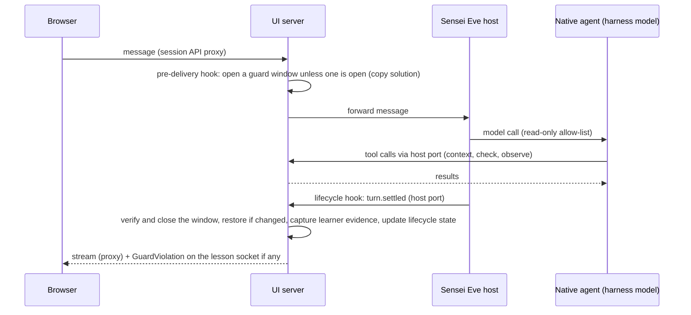

# One runtime for Sensei and Kyoshi: `@dojofoo/harness` and `@dojofoo/agents`

*   **Author:** tomsiwik
*   **Status:** Approved (2026-11-03)
*   **Date:** 2026-11-02

Source of decisions: `concepts_brief.md`, the EGM brainstorm brief, a local working file not kept in the repository (brainstorm rounds 1-12, accepted by the user on 2026-11-02), plus the user's request of 2026-11-02 that pages be addressed by what is edited or studied, with a session-history menu. Every decision this draft relies on is listed in the Decisions table below; D29-D33 are new in this draft.

Conventions:

*   **Baseline.** Branch `eve-1` at `a91ce0f` (worktree `.worktree/mobile`): Eve 1.0, Kyoshi on Eve, the agent-mismatch recovery in `agent-chat.tsx` and the relinking of managed Kyoshi apps, merged with PR #217 `feat/local-course-authoring` (course registry, `packages/config/src/agents.ts`, the `/course/$courseId` and `/session/$sessionId` routes, chapters). Paths that are new in this baseline compared with `main` are marked "(baseline)".
*   **Citations.** File references are relative to the repository root and written `path:line`. "Eve docs/<path>" means `packages/agent/dist/eve/docs/<path>`. "Unverified" marks a claim not confirmed in code, docs or a command.
*   **Cited versions.** `@ai-sdk/harness` 1.0.167, `@ai-sdk/harness-codex` 1.0.169, `@ai-sdk/harness-fx` 1.0.83, `@ai-sdk/harness-acp` 1.0.106, `@ai-sdk/harness-claude-code` 1.0.171.

--------------------------------------------------------------------------------

## Overview

dojofoo is a CLI (`npx dojofoo`) that opens a local web UI. A learner studies a course with Sensei, the teaching persona. An author writes a course with Kyoshi, the authoring persona. Both personas run on the user's own coding agent: Claude Code, Codex, Cursor, FX, Grok, OpenCode or Pi. Antigravity is planned separately (D23).

This design moves Sensei onto the Eve runtime that Kyoshi already uses, so both personas share one runtime and one list of coding agents. It regroups the code into two private packages: `@dojofoo/harness`, which runs and connects agents, and `@dojofoo/agents`, which defines the personas. It also changes how pages address conversations: a page names the draft, lesson or interactive course being worked on, the default conversation (D29) opens by itself, and earlier conversations are reachable from a history menu instead of the URL.

## Background

*   **Eve** is the agent runtime dojofoo embeds in `packages/agent` (`packages/agent/README.md`). An Eve server process hosts conversations ("sessions") for one agent definition. A **session** is one conversation. A **delivery** is one message sent into a session; Eve turns accepted deliveries into **turns**. A turn **pauses** when it waits for the user, for example on the built-in `ask_question` tool, and resumes in the same turn when the answer arrives; it **settles** when it ends (completed, failed or cancelled). A session is **stranded** when another Eve version built it and Eve 1.0 cannot run it (409 `session_stranded`). See Eve docs/concepts/sessions-runs-and-streaming.md, Eve docs/tools/human-in-the-loop.md and Eve docs/guides/hooks.md.
*   **Eve's World** is the durable store Eve keeps a host's sessions, runs and events in; locally it is `.eve/.workflow-data` (Eve docs/concepts/execution-model-and-durability.mdx:20), with no base directory stated. This design assumes it sits under the persona host's app folder, `<workspace>/.dojo/<persona>-app` (Kyoshi today: `packages/authoring/src/eve/prepare.ts:35`), so one World would serve every agent a workspace has used; the assumption is unverified.
*   **UI server** is the dojofoo server process that `dojofoo ui` starts (the "UI daemon" in CLI help); it serves the web UI, the session API and the host port. One UI server runs per `DOJOFOO_HOME` (see "Startup and recovery order").
*   **The harness model** (`experimental_createHarnessModel`, `packages/agent/src/harness-model.ts`) is an AI SDK model provider that drives a native coding-agent CLI through an `@ai-sdk/harness-*` adapter. Eve treats that CLI as its model: one Eve model call runs the native agent's whole tool loop. The running native agent is the **native session**. When an Eve turn pauses, the native session is **parked** (detached, still running) so it can continue; **eviction** stops its sandbox and drops it, after which the adapter must recover the conversation on the next turn.
*   **The loopback model** (`packages/agent/experiments/model-provider/loopback-openai.mjs`) is a local, scripted model endpoint with no paid inference; conformance tests point a real coding-agent CLI at it to drive deterministic tool calls.
*   **Workspaces.** A workspace is any folder registered in dojofoo's local state (`~/.dojofoo/dojofoo.db`, table `workspaces`; `listWorkspaces`, `packages/config/src/local-state.ts:189`). Its id is the `workspaceId` in `/api/v1/workspaces/{workspaceId}`. Its kind is `learner`, `draft` or `evaluation-trial` (added in step 2):
    *   A **learner workspace** is a project folder with courses installed under `courses/<id>`. Sensei runs there. A **course run** (`runId`) identifies one (workspace, course) pair (`observeCourseRun`, `packages/config/src/local-state.ts:197` (baseline)).
    *   A **draft** is an authoring folder, by default a managed one under `~/.dojofoo/drafts/course-*` created by `createDraft` (`packages/ui/src/server/control/drafts.ts:20-34`) and registered as a workspace (`observeWorkspacePath`). A draft's `draftId` is its `workspaceId`. Kyoshi runs there. An editable master copy installed with `dojofoo add --master` sits inside a learner workspace at `courses/<id>`; this design treats it as its own draft workspace (unverified, open risk 9).

    Sensei never runs in a draft. Two kinds of throwaway workspace are created from a draft by `createLessonTrial`: a **manual trial**, which the author opens from the Trial tab in a browser (`packages/authoring/src/server/routes.ts:112-116`, reached from `packages/ui/src/routes/authoring.tsx:290-313`) and which is an ordinary learner workspace with every learner rule; and an **evaluation trial**, which the evaluation run creates and drives without a browser (`packages/ui/src/server/lesson/authoring-handoff.ts:77`) and which registers with kind `evaluation-trial`. Only evaluation trials get the trial-only rules (host stops with the trial, per-trial budget, no leave rule). Each workspace has one coding-agent selection (D6, D20). Authoring and learning use different agents only when their workspaces have different selections.
*   **Course types.** A **kata** course has lessons, each with a solution file the learner edits and checks (tests) the learner runs. An **interactive** course has one sequence of material and questions, no editor and no checks. The terminal `dojofoo kata` command is unrelated to this design: it prints lessons for the user's own coding agent outside the web UI.
*   **"Sensei never types for you"** is the product rule that Sensei explains and asks but never edits the learner's solution.
*   **Persona dot** is the coloured dot before the persona's name in the chat header.
*   **Learner evidence** is a bounded set of excerpts kept per lesson: at most 8 recent excerpts of at most 400 characters each from the lesson conversation's learner and Sensei messages (`packages/ui/src/server/lesson/learner-evidence.ts:5-6,18`). Sensei's `observe` tool may only cite these (`packages/ui/src/server/lesson/learner-observations.ts`). A new conversation can be **seeded** with them; how this design captures and stores them is under "Sessions and leaving".
*   **Guard window** is the span during which the write guard watches the lesson's solution file: it opens before Sensei's model can start or resume and closes when Sensei's turn pauses or settles (see "Write guard").
*   **Two things named "agent-api".** The **session API package** (`packages/agent-api`) serves `/api/v1/workspaces/{id}` and proxies each session's Eve routes. The **UI server's AgentRuntime** (`packages/ui/src/server/agent-api.ts`) implements it inside the UI server: hosts, records and agent selection.

## The Problem

Sensei and Kyoshi run on two different stacks:

*   Kyoshi runs on Eve (`packages/agent`, `packages/authoring/src/eve`) with the AI SDK harness adapters (`@ai-sdk/harness-*`).
*   Sensei runs on a hand-written ACP client (`packages/ui/src/server/lesson/codex-client.ts`, 870 lines) with its own adapter list (`packages/ui/src/server/harness/`), streamed to the browser as AG-UI events (`packages/ui/src/server/lesson/agui-stream.ts`) into TanStack AI `useChat`.

Each stack keeps its own list of coding agents, and the lists have drifted. On the baseline:

*   Sensei runs Claude Code, Codex, Cursor, FX, Grok and OpenCode over ACP (`packages/ui/src/server/harness/registry.ts`; Claude Code through `claude.ts` and `@agentclientprotocol/claude-agent-acp`) and rejects Pi (`registry.ts:22-23`).
*   Kyoshi runs Claude Code, Codex, Cursor, FX, Grok, OpenCode and Pi on Eve (`packages/authoring/src/eve/harness.ts`; Claude Code since 2026-11-01).
*   Neither runs Antigravity.

Seventeen separate agent lists exist, for example `packages/ui/src/server/harness/registry.ts` and `packages/authoring/src/eve/harness.ts` (listed under the roadmap's step 2). They have drifted apart, so Sensei rejects Pi while Kyoshi runs it. That breaks a hard requirement: every coding agent must run both personas.

Three more problems follow from the split:

*   **Nothing enforces "Sensei never types for you".** Sensei runs every agent with full write access (Claude Code `bypassPermissions`, Codex `danger-full-access`, Cursor `--yolo`, Grok `bypassPermissions`, FX `yolo`, OpenCode `edit: allow`; `packages/ui/src/server/harness/claude.ts:12`, `codex.ts:28`, `native-acp.ts:37,48,61`, `opencode.ts:49-57`). The only guard is one sentence in a prompt (`packages/ui/src/server/lesson/contracts/DOJOFOO.md:28`).
*   **Course evaluation is a second runtime.** Kyoshi's evaluate tool spawns `teaching-eval.js`, which imports the UI server's ACP code by relative path (`packages/cli/src/teaching-eval.ts:31-33,52`).
*   **Pages address a workspace and a raw session id.** `/authoring?workspace=…&session=…` pins one Eve session. When that session's coding agent is no longer selected, the page can reach a dead end ("OpenCode isn't this workspace's selected coding agent"). `eve-1` now recovers by opening the selected agent's conversation (`packages/ui/src/components/agent-chat.tsx:64-77`), but a stale session id in the URL triggers that recovery on every visit, and a conversation becomes unreachable once it is replaced.

## Goals

*   **G1.** Every coding agent dojofoo offers runs both Sensei and Kyoshi on one Eve-based path. An agent is offered only after it passes the persona-by-agent conformance tests (D1, D24).
*   **G2.** One coding-agent registry. Every agent list, schema, route check and test reads from it.
*   **G3.** Sensei has no native write or shell capability on any offered agent (prevention, D18). A guard restores the lesson's solution file if it changes while Sensei's model is working, and tells the learner (D8, D21).
*   **G4.** Dependencies flow one way, `protocol <- harness <- agents <- (ui server, cli)`, checked by a lint rule; the harness exports a closed set of entry points for UI-server, CLI and browser consumers, and an explicit set of Eve subpaths for persona builds, both listed under the roadmap's step 8.
*   **G5.** Course evaluation runs through the production learner path inside the UI server, with one consent setting (D10, D15).
*   **G6.** Pages address what is edited or studied. The default conversation opens automatically, earlier conversations are reachable from a history menu, and no error the chat can receive ends without an action (D29-D33).
*   **G7.** Only the `dojofoo` CLI is published (D5).

## Non-Goals

*   Migrating stored ACP conversations, learner state or settings. No live lessons exist (D9).
*   Per-role evaluation models in the product (D10).
*   Renaming the `/agents` endpoint (D4); offering the evaluation learner or judge as selectable personas.
*   Generic "any ACP agent" support.
*   OS-level sandboxing of coding agents, and files outside the workspace.
*   A hosted runtime. The guard and the write prevention are designed for the local UI server only.
*   Antigravity's adapter. It is designed in its own brief and enters the registry only after it passes conformance (D23).
*   The terminal `kata` path, which prints lessons for the user's own coding agent (D22).

## Decisions

Status "Decided" is the user's decision; "Accepted" is the design's, settled in review. "Decided (behaviour), Accepted (mechanism)" means the user decided what happens and the design chose how. "Accepted (user request)" means the user asked for the feature and the design chose its form. "Recommended, pending user confirmation" means the design recommends it and the user has not yet confirmed it. A date marks a decision the user made after accepting the brief; every other decision comes from `concepts_brief.md`.

| Id | Decision | Status |
| --- | --- | --- |
| D1 | Every offered coding agent runs Sensei and Kyoshi; an agent is offered only after it passes conformance for both. From step 5 the offered set is read from the conformance record; an agent without a passing record for both personas (Cursor until tier B) is not offered for either persona. | Decided |
| D2 | `@dojofoo/harness` owns running and connecting agents (Eve, adapters, registry, hosts, session API, chat hook). | Decided |
| D3 | `@dojofoo/agents` holds persona definitions only; `packages/authoring` dissolves into it. | Decided |
| D4 | `/agents` keeps meaning coding agents; personas are chosen by mode, never by users. | Decided |
| D5 | Only the `dojofoo` CLI is published; `@dojofoo/config` is deprecated on npm and made private. | Decided |
| D6 | One coding agent per workspace runs both personas; per-lesson and per-conversation pickers go. | Decided |
| D7 | Learners can switch Sensei's model per session on every agent. | Decided |
| D8 | A change Sensei makes to the solution file is reverted and the learner is told. | Decided |
| D9 | No live lessons exist: breaking changes are allowed, nothing stored is migrated. | Decided |
| D10 | Evaluation uses an ordinary learner session on a throwaway install; all roles on the course's agent (the draft's selected agent, copied to the evaluation trial); one consent setting. | Decided |
| D11 | Dependencies flow `protocol <- harness <- agents <- (ui server, cli)`; the harness imports no persona. | Accepted |
| D12 | Agent ids are dojofoo's (`claude`, `grok`, …); adapter ids stay inside the harness. | Accepted |
| D13 | One Eve host process per (workspace, persona); a Sensei host serves every course of its workspace. | Accepted |
| D14 | Package moves and renames come last, as pure moves. | Accepted |
| D15 | Evaluation runs inside the UI server through the learner's own entry points. | Accepted |
| D16 | Server-sent turns are the begin turn and check reports. A check report is sent only when no turn is working or paused, otherwise held. Check is never disabled; Sensei keeps reacting to checks. | Decided (behaviour), Accepted (mechanism) |
| D17 | One Sensei agent serves kata and interactive courses; tools depend on the course type. | Accepted |
| D18 | Sensei, the evaluation learner and judges run read-only: tool allow-list, or `allow-reads` with denial; no approval reaches the learner. | Accepted |
| D19 | One default live Sensei conversation per (course, lesson) on the selected agent, reused on return; leaving a lesson cancels a paused turn; an ended or stranded Sensei session is replaced automatically when the lesson opens and never opens read-only. | Accepted |
| D20 | Each workspace (learner workspace or draft) holds its own agent selection; trials copy the draft's. | Accepted |
| D21 | The guard restores only changes made while Sensei's model is working; the learner's own saves at other times are kept. | Decided |
| D22 | Evaluation starts from the authoring page or Kyoshi's evaluate tool; the `dojofoo kyoshi evaluate` command is removed. The terminal `kata` path is out of scope. | Decided (2026-11-03) |
| D23 | Antigravity is designed in its own brief and offered after conformance. | Accepted |
| D24 | Conformance separates prevention (zero guard events) from the guard; an agent whose prevention cannot be shown is not offered. | Accepted |
| D25 | Kata lessons advance through Sensei's completion question, with "Open next lesson" once checks pass. | Accepted |
| D26 | A new lesson starts on the workspace's last model for that agent; the picker is disabled while a turn is paused. | Accepted |
| D27 | A harness lifecycle hook on every persona host verifies on pause/settle and stops parked native sessions; recovery is the adapter's. | Accepted |
| D28 | A failed resume is reported and the session replaced; every new session comes from the UI server's serialised get-or-create (see "Replacement rule"); the unanswered message stays in the composer. | Accepted |
| D29 | A page opens its default conversation automatically; the page component asks the UI server whenever the page key changes (`POST /sessions/default`), which gets or creates it, one per page key: (workspace, Sensei, course, lesson) for a kata lesson, (workspace, Sensei, course) for an interactive course, (draft, Kyoshi) for a draft. | Accepted (user request, 2026-11-02) |
| D30 | Pages are addressed by draft id or by course run and lesson (`/authoring/$draftId`, `/learn/$runId?lesson=<lessonId>`); opening a page never changes the workspace's current course. | Accepted (user request, 2026-11-02) |
| D31 | A history menu lists a page's conversations on every agent; picking one on another agent switches the workspace's agent after confirmation. | Decided (2026-11-02) |
| D32 | Opening a page replaces an ended newest conversation automatically, for both personas. Read-only applies only when an author picks an ended Kyoshi conversation from the history menu. | Accepted (user request, 2026-11-02) |
| D33 | From step 4 on, no error the chat can receive ends without an action. | Accepted (user request, 2026-11-02) |
| D34 | Sensei runs with dojofoo's own tools plus read-only built-ins only. None of the user's configuration loads: no settings, rules, skills, plugins, MCP servers or account connectors, for every agent, by whatever each CLI needs (flags, a private config home, a private `HOME`, tool filtering). Where a built-in cannot be removed, its permission request is refused. Per-agent findings are in the step 4 plan. Until a passing Sensei conformance record exists for an agent tier A cannot drive (Cursor), interactive Sensei refuses it (step 4). | Decided (2026-11-04) |
| D35 | Each step's file-level plan is kept at `docs/designs/agent-runtime.steps/step-<n>.md`, next to this design. | Accepted (2026-11-04) |

## Relation to Earlier Designs

`docs/architecture/agent-runtime-consolidation.md` (status "not yet approved") covers the same goal. This design takes the following positions on that document:

*   "Keep authoring and learning preferences independent" (`docs/architecture/agent-runtime-consolidation.md:228`): superseded by D6, the user's decision of 2026-11-01.
*   "Do not offer Claude support until the exact implementation and applicable terms have been reviewed" (`agent-runtime-consolidation.md:25,95,102`): superseded by D1, the user's hard requirement that every agent runs both personas. The integration uses the unmodified Claude Code binary with the user's own login through the official adapter (`@ai-sdk/harness-claude-code`). The terms review that doc asks for is not part of this design; it is open risk 7.
*   "Run the existing OpenCode ACP route and candidate route against the same saved lesson" before retiring ACP (`agent-runtime-consolidation.md:125,364-371`): rejected. No live lessons exist (D9), so there is no behaviour to preserve beyond what the tier-A conformance matrix (see "Conformance tiers") and the rewritten verify scripts assert.
*   "Do not add a global state-machine framework by default" (`agent-runtime-consolidation.md:44`): kept. The per-session lifecycle state is one persisted record per session (fields under "Session lifecycle"), changed by plain functions, not a framework. It exists because D16 (held check reports), D19 (cancel on leave) and D28 (replacement) all depend on whether a turn is working or paused, and that answer must survive a UI-server restart.

Its "Kyoshi stays independent" rule (`agent-runtime-consolidation.md:40`) still holds. Step 7 marks that doc and `docs/architecture/run-coordinator.md` superseded.

## Open Questions

None.

Resolved:

*   **Q1.** Picking an older conversation on another agent switches the workspace's agent after confirmation (D31; user, 2026-11-02).
*   **Q2.** The learning URL is `/learn/$runId?lesson=<lessonId>` (D30), renaming the baseline's `/session/$sessionId`, because "session" there means a course run, not a conversation; `/session/$sessionId` redirects to it with the same id (Elephant, stage 9 round 1, 2026-11-02).

## Critical User Journeys (CUJs)

### CUJ 1: A learner works through a kata lesson

*   **Given**: a workspace with an installed kata course and a selected coding agent that has passed conformance.
*   **When**: the learner opens a lesson, asks Sensei a question, edits the solution and presses Check.
*   **Then**: the lesson's conversation opens by itself (new on first visit, the same one on return). Sensei answers without any approval prompt. Check runs in the UI server; Sensei reacts to the result; if a turn is working or paused, the check card says Sensei will see it after it finishes. Sensei never changes the solution file; if a change appears while Sensei is working, the file is restored and the learner is told where the other version is.

### CUJ 2: The learner leaves a lesson while Sensei waits on a question

*   **Given**: Sensei has asked a question and the turn is paused.
*   **When**: the learner opens another lesson page, or the lesson page's socket stays closed for 30 seconds (for example, the tab is closed).
*   **Then**: the paused turn is cancelled and its coding-agent process stops. On return, the question shows as interrupted; Sensei's next turn sees the interrupted question in its conversation and can ask it again.

### CUJ 3: The workspace's coding agent changes

*   **Given**: a learner workspace whose lessons have conversations on Codex.
*   **When**: the learner selects Claude Code in the composer's agent menu and confirms "Switch this workspace to Claude Code?".
*   **Then**: running and paused turns are cancelled and allowed to settle (a turn that does not settle within 10 seconds is marked interrupted and is never continued by Claude Code), the Codex host stops, and the selection is saved. The open lesson reloads its default conversation, which on Claude Code is new (the default lookup takes only conversations on the selected agent, so it never resolves to the Codex conversation) and seeded from learner evidence; every other lesson does the same when opened. The Codex conversations are not ended: they stay listed in the history menu, and picking one offers to switch back (D31). Switching back reopens the Codex conversation as it was, with an interrupted turn shown as stopped; it is not re-seeded with evidence gathered on Claude Code.

### CUJ 4: An author opens a draft from a stale link

*   **Given**: a link `/authoring/<draftId>?session=<id>` whose session ran on OpenCode, and the draft's selected agent is now Claude Code.
*   **When**: the author opens the link.
*   **Then**: the newest live Claude Code conversation for the draft opens (or a new one starts), the URL drops the stale session, and the OpenCode conversation is listed in the history menu. No error is shown.

### CUJ 5: Picking an earlier conversation

*   **Given**: a draft whose selected agent is Claude Code, with three Kyoshi conversations, one of them on Pi.
*   **When**: the author opens the history menu next to Kyoshi's dot and picks the Pi conversation.
*   **Then**: dojofoo asks "Switch this workspace to Pi? Kyoshi will use Pi for this draft." On confirm, the workspace's selection becomes Pi, the Claude Code host stops (its conversations are not ended), a Pi host starts, and the Pi conversation continues. On cancel, nothing changes.

### CUJ 6: An author evaluates a course

*   **Given**: a draft and the author's consent to spend paid usage.
*   **When**: the author asks Kyoshi to evaluate a lesson.
*   **Then**: the UI server creates a throwaway install like a learner's, on the draft's agent. A simulated learner works through the lesson with Sensei through the same actions a learner uses. Judges score the transcript. The report appears in the authoring page. A guard violation or a change to installed material fails the trial.

### CUJ 7: A coding agent is offered

*   **Given**: a coding agent and its AI SDK adapter at a pinned version.
*   **When**: the conformance matrix runs for both personas.
*   **Then**: the agent appears in the registry's offered list only if it passes, including adversarial write attempts with zero guard events, resume after eviction and after a host restart, cancel while a host tool is pending, a model switch, and switching away and back to continue an old conversation (see "Conformance tiers").

## Technical Plan (Architecture)

### Packages and dependency direction (D2, D3, D11, D14)

```text
@dojofoo/protocol   data and types only: persona ids, coding-agent ids and capability rows,
                    host-port request/response types, GuardViolation, ResumeFailure
       ^
@dojofoo/harness    adapter factories + registry, model discovery, Eve build and persona hosts,
                    local sandbox, harness model (incl. prevention and one-shot calls),
                    lifecycle hook (Eve extension), session API (/api/v1), host-port server skeleton,
                    browser chat hook and message projection
       ^
@dojofoo/agents     kyoshi/ and sensei/: instructions, tools written against the host port,
                    skills, templates, prompts; learner and judge prompts;
                    each persona's prepared build (exports its prepared-output path)
       ^
ui server           composition root: maps mode to persona, serves host-port handlers,
                    owns the write guard, session lifecycle and evaluation, mounts the session API
cli                 starts or calls the UI server; prepares harness installs
```

*   `@dojofoo/config` (CLI and course configuration, private) depends on `protocol` for agent ids.
*   `@dojofoo/uix` depends on `protocol` only.
*   `packages/evals` (dev only) depends on `harness` and `agents`.
*   The harness never imports a persona. Persona hosts receive `{ appDir, preparedOutput, runtimeConfig }` from the composition root (D11).
*   Until step 8, `@dojofoo/harness` lives at `packages/agent` (+ `packages/agent-api`) and `@dojofoo/agents` at `packages/authoring`; step 8 is a pure move (D14).

### Runtime flows (D8, D16, D19, D21)

Three processes take part: the browser, the UI server (composition root, guard, lifecycle), and the persona's Eve host, which runs the native coding agent through the harness model. Each step names its owner.

Learner message:



Held check report:

```mermaid
sequenceDiagram
  participant B as Browser
  participant U as UI server
  participant E as Sensei Eve host
  B->>U: Check pressed (REST)
  U->>U: run checks; lifecycle state is working/paused -> hold latest report
  E->>U: lifecycle hook: turn.settled
  U->>U: verify window; state idle; report not stale
  U-->>E: hook response
  U->>U: guard window opens (rule 1)
  U->>E: send [dojo:check] turn, turnPolicy queue
  U-->>B: check card "Sensei saw this" on delivery.consumed
```

Pause and leave:

```mermaid
sequenceDiagram
  participant B as Browser
  participant U as UI server
  participant E as Sensei Eve host
  participant N as Native agent
  E->>U: lifecycle hook: turn.paused (question)
  U->>U: verify and close window; state paused
  B--xU: last lesson socket closes
  U->>U: 30 s without reconnect, or another lesson opened
  U->>U: held report dropped
  U->>E: cancel paused turn (turnId)
  E->>N: lifecycle hook stops and evicts the parked native session
  E->>U: turn.settled (cancelled); state idle
```

The UI server has three lifecycle inputs, and they cannot be merged: the pre-delivery hook is the only point that runs before Eve receives a delivery (guard rule 1); the host port is the only path from the Eve host into the UI server; the lesson socket is the only signal that the learner is present. All three feed one per-session lifecycle record (see "Session lifecycle").

### Coding-agent registry (D1, D12, D24)

One registry row per agent in `protocol` (data) and one adapter factory per agent in `harness`. A row holds:

*   `id` (dojofoo id: `claude`, `codex`, `cursor`, `fx`, `grok`, `opencode`, `pi`, later `agy`), display name, install command and docs (today's `packages/config/src/agents.ts` (baseline) moves here).
*   `adapterId` (`claude-code`, `grok-build`, …), used only inside the harness (D12).
*   Prevention mechanism for read-only personas, one of:
    *   `filter`: an `activeTools` allow-list. Claude Code, Codex, FX, OpenCode, Pi. Filtering support is shown at `@ai-sdk/harness-codex` `src/codex-harness.ts:231` and `@ai-sdk/harness-fx` `src/fx-harness.ts:105-106`; for Claude Code, OpenCode and Pi it is unverified (open risk 8).
    *   `deny`: an adapter wrapper plus `allow-reads` with approvals denied. Cursor, Grok.
*   Permission mode for read-only personas: `allow-all` for Codex (its adapter accepts nothing else, `@ai-sdk/harness-codex` `src/codex-harness.ts:238-243`; the allow-list removes its write and shell tools), `allow-reads` for the others.
*   User-config isolation for read-only personas: the sandbox environment, private home and adapter settings that keep the user's configuration from loading (D34), per agent in `agent-runtime.steps/step-4.md`, "Per-agent isolation and prevention".
*   Read-only built-in tool names, for the allow-list.
*   Model discovery method (see "Model selection").
*   Conformance record: adapter version, CLI version range, date, tier, result per persona. Only rows whose latest record passes for both personas are offered (D1).

### Conformance tiers (D1, D24)

*   **Tier A** runs on every pull request against the loopback model, for every agent whose CLI can be pointed at it; merging is blocked on it.
*   **Tier B** runs against real models with the user's logins, for agents tier A cannot drive (Cursor today) and as a release check for every offered agent at the release commit, at a recorded CLI version.
*   In addition to the cases step 3 adds, cases include a model switch (D7), switching away and back to continue an old conversation (D31), switching agents and then opening the page to assert that the new agent got a new session id (D29), an agent switch during a working turn, a host start after an Eve version change with a session left `working` (reconciliation closes its window), and, for agents without user-config isolation, a write attempt through a write-capable MCP server in the user's own config.
*   Tier B also opens N lessons in quick succession and records the native process count and token use, to show that leaving cancels begin turns that are still working.
*   Latency target, checked in tier B: the median time from a learner message to Sensei's first visible output is at most 15 seconds per agent. An agent above it is flagged in its conformance record, not removed.

### Persona hosts (D13, D19, D27)

*   One Eve server process per (workspace, persona) (D13): Sensei hosts per learner workspace, Kyoshi hosts per draft workspace. Hosts are generalised from today's Kyoshi runtime (`packages/authoring/src/eve/runtime.ts`).
*   States: `starting`, `ready`, `crashed`, `restarting`, `stopped`, owned by the UI server per (workspace, persona). A host that exits on its own is restarted on the next request.
*   A host is **idle** when no lesson socket or authoring page socket for its workspace is open and none of its sessions is working or paused. The authoring page socket is the authoring watch socket, keyed by the page's `$draftId` (D30). An idle host is stopped after 15 minutes. A paused Kyoshi turn is cancelled 30 seconds after the last authoring socket for its draft closes (Kyoshi's leave rule under "Sessions and leaving"), so it cannot keep a host busy.
*   An evaluation trial's Sensei host stops when its trial ends. A manual trial's host follows the learner rules (idle stop). There is no global cap; memory per host is measured in tier B.
*   Sensei hosts in learner workspaces, manual trials included, set `limits.sessionTimeoutMs: false` (D19) and `limits.sessionUsage: false`, so no budget prompt reaches a person (D18). An evaluation trial's Sensei host instead sets a per-trial `limits.sessionUsage` ceiling (see "Evaluation").
*   Every persona host sets `experimental.workflow.retention: "default"`, so ended sessions stay readable: without it, private sessions outside development request deletion when they end (Eve docs/agent-config.md:432-448, 488). Whether the local World deletes a session's data when `retention` is `0` is unverified (open risk 11). If a session's data is gone anyway, the history menu shows it as "no longer available" and opening it falls back to D29.
*   Process-group records, what happens when a host stops, the order in which hosts start and recover, reconciliation with Eve, and the single-UI-server lock are in "Startup and recovery order".
*   `EVE_BASE_URL` is removed; tests use the fixture runtime instead.

### Session API and page addressing (D29-D33)

The session API (`/api/v1/workspaces/{workspaceId}`, today `packages/agent-api`) keeps `/agents` meaning coding agents (D4) and gains:

*   `SessionRecord` fields: `courseId?`, `lessonId?`, `model?`, `revision` (integer), `firstMessage?` (the opening of the first untagged learner or author message, written by the pre-delivery hook; at most 80 characters), `endedAt?`, `replacedBy?`, `unavailable?`, and the `lifecycle` sub-object (see "Session lifecycle").
*   `GET /sessions` gains `course` and `lesson` filters; without `agent` it already lists every agent, newest first (`packages/agent-api/src/app.ts:55-60`). This is the history menu's data source. Only records are listed across agents; a conversation's messages are read only from its own agent's host, so picking another agent's conversation switches the workspace first (D31).
*   `POST /sessions/default` (body: `course`, `lesson`, and optionally `session: <id>` from the URL, or `new: true` with `from: <session id>`) gets or creates the page's default conversation (D29). A `session` that passes the checks below is returned as is; otherwise the response carries the default conversation and tells the browser to rewrite the URL. `new: true` skips the lookup and always creates a new conversation; "Continue in a new conversation" uses it. The page component calls the route whenever the page key changes (after mount, and when `?lesson=` changes), never from a route loader or a preload (the router preloads on intent, `packages/ui/src/router.tsx:9`). It is one of the two routes under the Origin and token checks this design adds (step 2). No other POST route matches its static path.
*   `POST /agents/{agentId}/select` writes the workspace's selection (D6, CUJ 3); Origin and token checked (step 2).
*   `PATCH /sessions/{id}` sets `model` (D7).
*   `GET /agents/{agentId}/models` returns `ModelChoice[]` (D7).
*   The persona comes from the workspace's kind, never from the request: a draft workspace runs Kyoshi; a learner workspace (manual trials included) or an evaluation trial runs Sensei. Today the API trusts `body.persona` (`packages/agent-api/src/app.ts:62`) and the AgentRuntime only checks for `kyoshi` (`packages/ui/src/server/agent-api.ts:139`), and the `workspaces` table records no kind. Step 2 records a `kind` (`learner`, `draft` or `evaluation-trial`). Every entry point that opens a folder for authoring sets `draft` explicitly, on first insert and on later registrations: `createDraft`, `dojofoo kyoshi` (`packages/cli/src/commands/kyoshi.ts:45-52`), `dojofoo ui --authoring` (`packages/cli/src/commands/ui.ts:45`) and a master copy opened with `--authoring` (`packages/cli/src/commands/add.ts:430`; open risk 9). A registration may change `learner` to `draft`, never the reverse. The evaluation run registers its trial as `evaluation-trial`; the manual Trial tab's install is `learner`. Today `observeWorkspace` writes a row only on first insert and afterwards touches only `last_seen_at` (`packages/config/src/local-state.ts:408-423`), so this needs an explicit update. Existing rows are backfilled at UI-server start with the dashboard's existing rule for what a draft is, extracted into one helper: a managed draft, a `.dojo/kyoshi.json`, or a Kyoshi session record (today inline in `packages/ui/src/server/control/routes.ts:241-245` and `:204-205`, with `newestKyoshiSession` at `:304-310`; `isManagedDraft`, `packages/ui/src/server/control/drafts.ts:15`) gives `draft`, else `learner`. `GET /api/control/authoring` then lists drafts by `kind`, so one rule decides what a draft is. A persona in a request body is ignored.
*   The browser no longer calls `POST /sessions`. Today the client picks agent and persona there and the Eve create runs inside the browser request (`packages/agent-api/src/app.ts:61-74`); the route is removed, so every new session comes from `POST /sessions/default` (D28).
*   Create no longer sends a message (today it sends the persona greeting, `packages/agent-api/src/app.ts:67-69`); it is a bodyless Eve create (Eve docs/channels/eve.mdx:62-66), and the begin turn is a separate send, so the record exists before Sensei's first model call reads it.

#### Default conversation (D29)

Whenever the page key changes, the page component asks the UI server (`POST /sessions/default`) for the default conversation of the page key (D29: (workspace, Sensei, course, lesson), (workspace, Sensei, course) or (draft, Kyoshi)). Under one in-process lock per page key, which is enough because one UI server runs per `DOJOFOO_HOME` (see "Startup and recovery order"), the UI server:

1.  Looks up the newest conversation for the key on the selected agent. The lookup takes only that agent's conversations, so a new agent never gets another agent's conversation. A usable one is returned; an unusable one goes through the "Replacement rule".
2.  Otherwise creates the Eve session (a bodyless create), then saves its record. A crash between the create and the save leaves an unused Eve session that no record names and that is never listed; this is accepted. The create is detached from the browser request, so a reload or a second tab during creation waits on the same lock and gets the same session.
3.  For Sensei, sends the begin turn and sets `lifecycle.beginPending` on the record until `delivery.consumed`. A begin left pending by a crash is resent on the next open with the same `idempotencyKey` (Eve docs/channels/eve.mdx:58); a begin cancelled because the learner left (see "Sessions and leaving") is resent with a new key, because the old key would return the original receipt.

A session id in the URL reaches the UI server as the route's `session` field and is honoured only if it belongs to that page key, the workspace and the selected agent and is usable; otherwise the default rule applies and the response tells the browser to rewrite the URL (the `eve-1` rule in `packages/ui/src/components/agent-chat.tsx:64-77`, extended to lessons and moved to the UI server).

#### Page addresses (D30)

Authoring is `/authoring/$draftId`, where `draftId` is the draft workspace's id. Learning is `/learn/$runId?lesson=<lessonId>`, where `runId` identifies (workspace, course) through the baseline's `observeCourseRun` (`packages/config/src/local-state.ts:197` (baseline)). `?session=` is an optional search parameter set only by a history pick; a read-only view does not put its id in the URL, so a reload returns to the default conversation.

The authoring page takes its workspace from `$draftId` for every authoring request and for the authoring watch socket. Today both read `?workspace=`: the socket URL at `packages/ui/src/routes/authoring.tsx:93`, and `withAuthoringWorkspace` and `authoringApi` at `authoring.tsx:563-578`. A request without it falls back to the launch folder (`packages/ui/src/server/control/workspace.ts:11-12`), so without this change every authoring request under `/authoring/$draftId` would reach the launch folder.

A manual trial opens `/learn/$runId?lesson=<lessonId>` for the trial install's course run. The Trial tab's "Trial agent" menu (`packages/ui/src/routes/authoring.tsx:481-483`) and its `?harness=` parameter (`authoring.tsx:320`) are removed: a manual trial uses the draft's agent (D20, D6).

Opening a page never changes the workspace's current course (`.dojorc` `currentDojo`). The lesson services take the course explicitly: `lessonTarget` and its callers address a course by id within the workspace (step 5), so host-port calls and guard windows resolve from the `SessionRecord`'s `courseId` and `lessonId`, whatever course is current. `currentDojo` changes only through a new "Make this my current course" control on a course that is not current. The control sends an explicit POST from the page component, never from a route loader, because the router preloads on intent (`packages/ui/src/router.tsx:9`). The existing "Continue learning" button only navigates (`packages/ui/src/routes/course.$courseId.tsx:62`). The terminal `kata` command keeps reading the current course.

Old forms redirect: bare `/authoring`, which `dojofoo ui --authoring` opens (`packages/cli/src/commands/ui.ts:279`), to `/authoring/$draftId` when the launch folder is a draft workspace (resolved with `observeWorkspacePath`, `packages/config/src/local-state.ts:208`), else to the dashboard; `/authoring?workspace=…`, with or without `&session=…`, to `/authoring/$draftId`, carrying the session for the D29 check as in CUJ 4. `/session/$sessionId` redirects to `/learn/$runId` with the same id, because the baseline's links already pass a run id there; an id that is not a run id lands on the dashboard. `/interactive?course=` keeps its existing redirect to `/course/$courseId` (`packages/ui/src/routes/interactive.tsx:7`). Every other old form (`/authoring?session=` without a workspace, the old manual-trial path) goes to the dashboard (D9). `/course/$courseId` and `/starter/$courseId` (baseline) are unchanged.

#### History menu (D31)

A menu next to the persona dot in the chat header lists the page key's conversations on every agent (from `GET /sessions`): agent, model, date, `firstMessage`, and state. The state shown comes from the record alone: live, or ended (`endedAt`); a replaced conversation (`replacedBy`) is also ended, because the UI server ends the old session when it records the replacement, and is labelled "replaced". A stranded conversation, or one whose data was deleted, is detected only when it is opened. Picking a conversation on the selected agent opens it and sets the composer's model from the record. Picking one on another agent asks "Switch this workspace to <agent>?" (naming the persona that runs there, and saying that the conversation continues if it still can, otherwise a new conversation starts on <agent>); on confirm, the switch under "Workspace agent selection" runs, then the picked conversation opens. Outcomes per persona and state are in the entry-path table under "Replacement rule".

#### Replacement rule (D28, D32)

One trigger: when the UI server finds the newest conversation for a page key **unusable**, it replaces it. A conversation is unusable when it has ended (`endedAt`, or Eve answers `409 session_not_active`), is stranded (`409 session_stranded`, or `session_version_unsupported` in the browser), its data is gone (`410 session_expired`), or the harness reported a failed resume for it (`resume.failed`). To replace it, the UI server ends the old Eve session if it has not ended, creates a new one through the default rule (D29), records `replacedBy` on the old record, and for Sensei seeds the new one from learner evidence. The unanswered message stays in the composer.

Who asks for the replacement:

| Situation | Who asks | How the browser learns |
| --- | --- | --- |
| A page opens, or a send or stream from the browser returns one of the codes above | the browser, through `POST /sessions/default` | the response; the URL is rewritten |
| The UI server's own begin turn fails after Eve's retries | the UI server | a `replaced` message with the new session id on the lesson socket (`/api/session`); the browser switches to it |
| An evaluation-trial session (no browser) | the UI server | not applicable |

How each entry path treats an ended or unavailable conversation:

| Entry path | Sensei | Kyoshi |
| --- | --- | --- |
| Opening the page (default) | an ended or stranded newest conversation is replaced automatically, seeded from learner evidence | an ended or stranded newest conversation is replaced automatically (a new conversation; the old one stays listed) |
| Picking from the history menu, conversation ended | listed as "ended", not openable | opens read-only with "Continue in a new conversation", which calls `POST /sessions/default` with `new: true` and so always creates a new conversation |
| Picking from the history menu, conversation stranded, or its data deleted | listed as "no longer available" | listed as "no longer available" |
| Picking a live conversation on another agent | confirm switching the workspace's agent (D31) | confirm switching the workspace's agent (D31) |
| Picking an ended conversation on another agent | listed as "ended", not openable | confirm switching the workspace's agent (D31), then open read-only |
| Picking a live conversation on another agent that turns out stranded or deleted after the switch | the default conversation on the new agent opens (D29), with a notice that the picked conversation could not be continued | the default conversation on the new agent opens (D29), with the same notice |
| Opening a URL with `?session=` whose conversation has ended or stranded | replaced by the default rule (D29), URL rewritten | replaced by the default rule (D29), URL rewritten |
| Picking a replaced conversation | as "ended" | as "ended" |
| Picking a conversation whose agent is no longer offered or whose CLI is missing (checked before the confirmation) | listed as "<agent> isn't available", no switch offered | listed as "<agent> isn't available", no switch offered |

This table applies D19 (Sensei never opens read-only) and D31.

#### No dead ends (D33)

A **bare error** is an error message shown alone, with no action. From step 4 on, the chat never shows one: every error it can receive maps to an action. Outcomes that open the default conversation go through the "Replacement rule" when the newest conversation is unusable.

| Code | Raised by | Meaning | Outcome |
| --- | --- | --- | --- |
| 409 `agent_unavailable` | UI server's AgentRuntime (`packages/ui/src/server/agent-api.ts:60`) | the conversation's agent is not the workspace's selected agent | default open (D29); from a history pick, the switch confirmation (D31) |
| 409 `persona_unavailable` | UI server's AgentRuntime (`agent-api.ts:139`) | Sensei is not on Eve yet | does not occur from step 4 on (the check is removed) |
| 409 `session_not_ready` | Eve (Eve docs/concepts/sessions-runs-and-streaming.md:38) | the session is still starting | Eve's client retries for up to 20 seconds (Eve docs/guides/frontend/use-eve-agent/index.mdx:207); then as `session_not_active` |
| 409 `session_not_active` | Eve (Eve docs/concepts/sessions-runs-and-streaming.md:353,377; Eve docs/channels/eve.mdx:102,104) | the session is unknown or terminal (also on a cancel) | on a send or stream: D32 by entry path; on a cancel: the chat shows the turn as stopped |
| 409 `session_stranded` | Eve (Eve docs/concepts/execution-model-and-durability.mdx:73-79,143) | built by another Eve version | default open replaces it; history lists it as no longer available |
| `session_version_unsupported` | Eve's client stream reader (`packages/agent/dist/eve/dist/src/client/open-stream.js`), in the browser | the session's format is not readable by this Eve | as `session_stranded` |
| 410 `session_expired` | Eve (Eve docs/channels/eve.mdx:157; Eve docs/agent-config.md:488) | the session's data was deleted | as `session_stranded` |
| 404 `session_not_found` | session API package (`packages/agent-api/src/app.ts:15`) | no such record in this workspace | default open (D29), URL rewritten |
| 404 `workspace_not_found` | UI server's AgentRuntime (`agent-api.ts:42`) | the workspace or draft no longer exists | "Back to the dashboard" |
| 400 `invalid_request` | session API package (`app.ts:32`) | a malformed request from the page | "Reload the page" |
| 403 `launch_token_invalid` | session API package (`packages/agent-api/src/launch.ts`), on the token-checked routes | the page's per-launch token is missing or from an earlier UI-server launch | the browser fetches the token again once and retries; a second refusal shows "Reload the page" |
| 404 `agent_not_found` | session API package (`packages/agent-api/src/app.ts:42,65`), UI server's AgentRuntime (`agent-api.ts:58`) | the page named an agent the workspace does not have | "Reload the page" |
| 404 `not_found` | session API package (`app.ts:33,88`) | an unknown route or Eve path | "Reload the page" |
| 413, 415 | Eve (Eve docs/channels/eve.mdx:116) | an attachment is too large or of an unsupported type | the composer keeps the message and says which file to remove |
| 503 `agent_failed` | UI server's AgentRuntime (`agent-api.ts:83-88`) | the selected agent's CLI did not start | "Choose another agent" with the workspace selector, plus "Try again" |
| 409 `agent_switching` | UI server's AgentRuntime (new; see "Workspace agent selection") | an agent switch is in progress and its bound passed | "Switching to <agent>…", then retry after the switch |
| 409 `agent_not_offered` | UI server's AgentRuntime (new check against the registry and `resolveAgentExecutable`) | the saved selection is no longer offered, or its CLI is missing | "Choose another agent" with the workspace selector |
| 409 `control_refused` | session API package (`packages/agent-api/src/app.ts:126`) | Sensei sessions refuse clear and compact; the chat never sends them | "Reload the page" |
| turn failed: sign-in needed | the native agent, on the stream as a failed turn | the agent's login is missing or expired | "Log in to <agent>" with the agent's login command, plus "Try again" |
| turn failed: rate limit | the native agent, on the stream | the agent's provider refused for rate or quota | "Try again" with the provider's retry time when given |
| turn failed: native crash | the native agent, on the stream | the CLI exited mid-turn | "Try again"; a second failure in a row offers "Choose another agent" |
| turn failed: interrupted by an agent switch | Sensei's model call, on the stream as a failed turn (`packages/authoring/src/sensei/agent.ts:38`, from the host port's 409 `turn_interrupted`) | the turn was interrupted by an agent switch, or belongs to another agent's session | the turn shows as stopped |
| other 5xx, network error | any | transient | "Try again" (today's reload conversation) |

The host port's 409 for a reused idempotency key with different input (step 4) goes to the Eve host, never to the chat.

### Host port (D11, D15)

*   An HTTP interface in the UI server that persona tools and the lifecycle hook call. It generalises today's run coordinator, which already routes bearer-authenticated calls to attached handlers (`packages/ui/src/server/run/coordinator.ts:18-58`, `run/routes.ts:7-27`, client in `packages/cli/src/lesson-mcp.ts:111-118`): the harness provides the server skeleton (secret check, idempotency, routing) and each composition root supplies handlers; `packages/evals` supplies stub handlers. The coordinator and the lesson MCP server are deleted in step 7.
*   **Secret:** the persona host's per-start secret. Today it is generated once per runtime object (`packages/authoring/src/eve/runtime.ts:74`), which is cached per root and reused when a host restarts itself (`runtime.ts:23-41,107`), and `runtime.json` gets mode 0600 only when it is created (`writeFile` with `mode`, `runtime.ts:106`). Step 4 moves the generation into `start()` and sets the mode explicitly on every write, so the secret changes on every host start. It authenticates both directions and never reaches the browser. It is readable by any process running as the user, including Kyoshi's shell: it keeps other users' processes and the browser out, not the user's own agents.
*   **Requests:** one route per (workspace, persona, method); each call is idempotent per tool call (key set in step 4's plan). The UI server resolves course, lesson and persona from the `SessionRecord`.
*   **Sensei methods:** `context` (lesson state, a content hash, the learner's file only when it changed since Sensei's last call in this session, the latest check result; the "last sent" marker resets on an eviction, a model change and a host restart, so the file is sent again), `observe` (record a learner observation), `show` (show an authored fragment), `check` (run the lesson's checks), `navigate` (next lesson, used by `complete`). `ask` reuses Eve's built-in `ask_question`; `complete` is a workflow tool with a step boundary around its `navigate` call.
*   **Kyoshi methods:** `evaluation.start` (returns an evaluation-trial id), `evaluation.status`, `evaluation.cancel`.
*   **Lifecycle methods (all personas):** `turn.paused`, `turn.settled`, `session.ended`, `resume.failed`. Kyoshi answers the guard part as a no-op.
*   Evaluation trials are asynchronous: `evaluation.start` returns immediately and Kyoshi's tool polls `evaluation.status`. The tool cancels the evaluation trial when its `abortSignal` fires.

### Lifecycle hook (D27)

*   An Eve extension shipped by the harness, applied to every persona host (not opt-in). The UI server does not mark a host `ready` unless its `/eve/v1/info` lists the extension. Unverified: that a dojofoo-built extension can be packaged with `eve extension build` and loaded by the prepared persona builds; if not, the hook is a hook file each persona build includes from the harness.
*   On `turn.paused` and `turn.settled` it calls the host port. When a turn settles cancelled or failed, or the session ends, it first stops the owned sandbox of a detached native session and evicts it, then calls the host port. Pi needs one extra cleanup step (step 4's plan).
*   The harness keeps a map from Eve session id to harness session, filled inside `doStream` after `createSession` (`packages/agent/src/harness-model.ts:141`); the Eve session id comes from each persona's `defineDynamic` `ctx.session.id` (step 4).
*   The hook catches its own errors; `guard.verify` is idempotent per (`turnId`, pause).
*   After an eviction or host restart, the next turn relies on the adapter's own recovery of a continuation whose live turn is gone, as the HarnessV1 contract requires (`@ai-sdk/harness` `src/v1/harness-v1-session.ts:242-248`). Conformance tests this per agent and persona.

### Write prevention (D18)

*   Each persona's prepared build fixes a mode, `read-only` or `full`, and Eve's `defaultTools: false` (Sensei adds `ask_question` and its own tools). A missing mode fails closed (`read-only`).
*   For a `read-only` call, the harness model builds the allow-list per call from the row's read-only built-ins plus the names of Eve's tools for that call (step 4).
*   `deny` rows run through an adapter wrapper that removes `builtinToolFiltering` in `doStart` (resume included) and runs `allow-reads`, so `HarnessAgent`'s existing denial (`@ai-sdk/harness` `src/agent/internal/run-prompt.ts:1079-1104`) answers every write or shell approval before it reaches Eve.
*   Any approval that still reaches `harness-model.ts:230-233` for a `read-only` persona ends the turn with an error and is never shown as a card. Each auto-denied approval is logged as a typed record.
*   Sensei's native process runs in an empty scratch directory, so learner content is not in its working directory. Read-only built-ins that accept absolute paths can still read other files (unverified per agent); the `context` tool is the intended path to the learner's file.
*   User config: for read-only personas the user-config isolation in `agent-runtime.steps/step-4.md`, "Per-agent isolation and prevention", applies, so the user's MCP servers, plugins and settings do not load. For an agent whose CLI has no such flag, a conformance case with a write-capable MCP server in the user's config decides whether it is offered (D24); those agents are open risk 10.
*   Sensei's instructions say not to narrate tool refusals.
*   Kyoshi runs `full`. It keeps its write tools and runs `allow-all`, so no approval cards appear for it.

### Write guard (D8, D21)

The guard is a backstop limited to three rules; timing cases beyond them are accepted residual risks. Interactive courses have no solution file, so the guard is a no-op there.

1.  **A window opens before Sensei's model can start or resume.**
    *   *When.* The UI server opens it synchronously before it forwards a learner message or answer (a pre-delivery hook it supplies to the session API) and before it sends a server turn, but only if the session has no open window. A delivery that joins a running turn (steering, Eve's default `turnPolicy`, Eve docs/channels/index.mdx:44) or waits in its queue reuses the open window. Recovery windows at host start are under "Startup and recovery order".
    *   *What counts as a delivery.* The session API forwards `/eve/*` requests as opaque bytes (`packages/agent-api/src/app.ts:82-105`), so the hook classifies each one: a request that sends a message or an answer is a delivery; cancel, end, stream reads and empty-body prepare requests (Eve docs/channels/eve.mdx:37) are not.
    *   *The copy.* Opening takes a byte copy of the lesson's solution file (resolved from the `SessionRecord`'s course and lesson) and persists it in the guard store in dojofoo's state directory, outside the workspace and outside Sensei's scratch directory (layout in `agent-runtime.steps/step-5.md`, "Harness file guard"). The copy in the guard store is the only record that a window is open. Writes the UI server makes while a window is open (an editor save, a scaffold on navigation) update the copy.
2.  **The window closes on Sensei's pause or settle hook**, which calls the host port's verify. A window is discarded when the delivery that opened it returns non-2xx or Eve accepts it without starting a turn; a failed delivery that joined an open window does not discard it.
3.  **A verify acts only on an open window.** It restores a changed solution file, moves the overwritten version to quarantine (one version per path, kept until the next violation on that path), writes through a temp file and rename, clears that lesson's check result and drops a held check report (as a save does), and emits `GuardViolation { sessionId, turnId, paths, action }`. With no window open it does nothing.

The learner sees a notice over the editor: the file changed while Sensei was working, the version from before Sensei's turn was restored, and the other version's path. Unsaved editor changes are kept and the restored file is offered instead. A notice raised at host start is persisted and shown when the lesson next opens. `GuardViolation` reaches the browser over the lesson socket (`/api/session`).

`writeLessonFile` becomes one guard-aware write function with a per-path lock and temp-file rename; all callers use it.

### Session lifecycle (D16, D19, D28)

One module in the UI server, `packages/ui/src/server/agent-session/lifecycle.ts`, owns each session's lifecycle: `status` (`idle`, `working`, `paused`, `interrupted`), the `turnId` from the last `turn.paused`, `beginPending`, the held check report, and the leave timer. It is the single source for D16's condition (status `idle`), D19's cancel and the "Replacement rule". The fields live in the session's record as a `lifecycle` sub-object, written through the AgentRuntime's existing serialised record store (one write queue, temp file and rename, `packages/ui/src/server/agent-api.ts:94-113`), which stays the only writer of `agent-sessions.json`; so one event updates one file. Guard windows stay in the guard store.

| Event | From | To | Side effect |
| --- | --- | --- | --- |
| pre-delivery (message, answer, server turn) | `idle`, `paused`, `interrupted` | `working` | guard window opens if none is open |
| pre-delivery while a turn runs (steering or queued) | `working` | `working` | reuses the open window, or opens one if none is open |
| delivery rejected (non-2xx) or accepted without starting a turn | `working` | the status before the pre-delivery hook | the window it opened is discarded (guard rule 2); a held report is sent under D16 if the status returns to `idle` |
| `turn.paused` | `working` | `paused` | guard verify; leave timer armed if no socket |
| `turn.settled` | `working`, `paused` | `idle` | guard verify; learner evidence captured (Sensei only); held report sent; `beginPending` cleared when it was the begin turn |
| leave cancel (D19; Kyoshi's leave rule under "Sessions and leaving") | `paused`, or `working` with `beginPending` | unchanged until `turn.settled` | held report dropped, then cancel with `turnId` |
| `session.ended` | any | `idle` | `endedAt` set on the record; held report dropped |
| `resume.failed` | `working` | `working` until `turn.settled` (failed) | the record is marked unusable; at that `turn.settled` the "Replacement rule" applies |
| host stops (agent switch, switch timeout, crash, idle stop) | `working`, `paused` | unchanged (unsettled) | see "Startup and recovery order" |
| switch timeout (old agent's turn not settled within the bound) | `working`, `paused` | `interrupted` | see "Startup and recovery order" |
| host start (at UI-server start or later) | `working`, record's agent = host's agent | `working` | recovery window (see "Startup and recovery order") |
| host ready, reconcile (before it accepts work) | `working`, `paused` with no active turn in Eve, or stranded or ended | `idle` | as `turn.settled` (see "Startup and recovery order") |

Other drops of a held report (a later save, navigation, a `context` read) are listed under "Server-sent turns".

### Startup and recovery order (D8, D19, D27)

Where state lives: session records, with their `lifecycle` sub-objects, live in `<workspace>/.dojo/agent-sessions.json`, because they belong to the workspace and move or disappear with it. Process-group records and guard copies live in dojofoo's state directory (`$DOJOFOO_HOME/state/`): guard copies must sit outside the workspace and outside Sensei's scratch directory, and process records describe processes of this machine's UI server, not of a workspace. File layouts are set in the plans for steps 4 and 5.

1.  **One UI server per `DOJOFOO_HOME`.** The UI server takes an exclusive lock file in `DOJOFOO_HOME` before anything below. A newly started server waits up to 15 seconds for the old one to release it, then refuses to start. This covers direct mode, where the pid file is per port so servers on different ports share state (`packages/cli/src/commands/ui.ts:226-229`), and portless mode, where the CLI spawns the new server before the forced route update stops the old one (`packages/cli/src/commands/ui.ts:89-104`).
2.  **Reap orphaned process groups** (at UI-server start, and before a host restarts). Each host records the process groups it starts, with each process's start time; today they live only in memory (`packages/agent/src/local-sandbox.ts:15-23`). Groups whose pid and start time still match are killed, so a process that has reused a recorded pid is never killed.
3.  **Verify every persisted guard window** (guard rule 3), before any host starts.
4.  **Before a host accepts work**, open a recovery window for every session of that host with an unsettled turn (lifecycle status `working`) whose record names the host's own agent. Eve recovers runs that were active at startup (Eve docs/concepts/execution-model-and-durability.mdx:65,143) without passing the pre-delivery hook; the recovery window covers the recovered run and closes on its pause or settle. A host never recovers another agent's session. A host refuses a model call for an `interrupted` session's interrupted turn, or for another agent's session, before the native agent starts (step 5).
5.  **Reconcile once the host is ready**, before it accepts work: the UI server reads the recorded state of every session whose status is `working` or `paused` with a bounded read (`follow=false`, Eve docs/channels/eve.mdx:144). Where no turn is active, or the session is stranded or ended, it applies the `turn.settled` transition: verify and close the window, cancel the leave timer, send or drop a held report under D16. A session with a live turn keeps its recovery window. Leave timers are re-armed for paused sessions with no socket. Eve skips a stranded root session's run at startup and does not rerun hooks for events already written (Eve docs/concepts/execution-model-and-durability.mdx:143,186), so without this step a window could stay open and revert the learner's own saves (D21). The same reconciliation runs for an old session when it is replaced.

When a host stops for any reason (agent switch, switch timeout, crash, idle stop), the UI server verifies and closes that host's open guard windows before the stop completes, cancels the leave timers of its sessions and drops their held reports. Sessions left unsettled when an agent switch times out are marked `interrupted`: their windows are verified and closed, and no host recovers them; the conversation shows the turn as stopped.

**Switch lock.** An agent switch (see "Workspace agent selection") holds a per-workspace lock. While it is held, the pre-delivery hook, get-or-create and host auto-restart for that workspace wait up to the switch's bound (10 seconds plus the host stop), then return 409 `agent_switching` (D33).

### Server-sent turns (D16)

*   Two kinds of server turn.
    *   The **begin turn** is the first message the UI server sends into a new Sensei session; its text is the `begin` entry of `packages/ui/src/server/lesson/contracts/TURNS.md` ("Begin the lesson.") plus any learner-evidence seed (in its own text, not in Eve `history`), and it asks Sensei to open the lesson for the learner. It is retried as described under D29; if Eve's client retries for `409 session_not_ready` give up, the "Replacement rule" applies.
    *   The **check report** is the `checks-ran` entry ("Ran lesson checks.") with the check result.
    *   Both are sent by the UI server through the session API under the learner's identity, start with a tag (`[dojo:begin]`, `[dojo:check]`), and are hidden in the chat by that tag at message start only.
*   A check report goes out with `turnPolicy: "queue"` only when the session status is `idle`. Otherwise the UI server keeps only the latest report and sends it after `turn.settled`, after any replacement has run. A report is dropped on a later save, on navigation or a D19 cancel (drop first, then cancel), on an agent switch, or once Sensei has read that check through `context`.
*   The check card shows: "Sensei will see this after it finishes" (held), "Sensei saw this" (consumed; source: `delivery.consumed` of the report's delivery or a `context` read), or "Sensei hasn't seen this; press Check again or ask" (dropped).
*   Sensei sessions refuse `/compact` and `/clear` through the session API.

### Sessions and leaving (D19, D25, D26, D28)

One default live Sensei conversation per (course, lesson) on the selected agent, reused on return. A session that ended, stranded after an Eve upgrade, or failed to resume is replaced (see "Replacement rule"). Every new session is created by the UI server's get-or-create (D29), serialised per page key, so no two replacements are made for the same old session from any number of tabs. A replacement's seed comes from the learner-evidence store, which the UI server fills at every `turn.settled` of a Sensei session per (workspace, course, lesson), or per (workspace, course) for an interactive course, and which no host switch or session end touches. Capture skips messages whose text starts with a `[dojo:` tag, so the begin turn, its seed and check reports never become learner excerpts (today every user and assistant text message is kept, `packages/ui/src/server/lesson/learner-evidence.ts:11-22`).

*   Leaving is defined per page, from one signal: a page's socket opening, which carries its key in the query (`course` and `lesson` for a kata lesson page, `course` for an interactive course page). A **kata lesson** is left when a lesson socket opens for another (course, lesson) in the workspace, or when its own lesson socket stays closed for 30 seconds. An **interactive course** is left when a course page socket opens for another course in the workspace, or when its own socket stays closed for 30 seconds. Then a paused turn of the left page's session is cancelled with its `turnId`, and so is a begin turn that is still working ("begin pending"); the lifecycle hook stops its process, and the begin is resent with a new key on the next open (D29). Any lesson or course socket that opens for a different page key in the workspace leaves the current page, across course types. An ordinary working turn on a left page runs until it settles. So working turns in a host are bounded by the page keys opened in its workspace: one session per page key, and Eve runs one turn per session at a time. Evaluation-trial sessions never count as left; manual-trial sessions follow the learner rule.
*   **Kyoshi** has the same rule through the authoring page socket (the authoring watch socket, `packages/ui/src/hooks/use-authoring-watch.ts:9,29`, keyed by `$draftId`, D30): when no authoring page for a draft has had a socket open for 30 seconds, the draft's paused Kyoshi turns are cancelled and D27 evicts their native sessions, so the host can reach the 15-minute idle stop.
*   The lesson socket (`/api/session`, today keyed by `?session=<id>` and opened only by the kata lesson page, `packages/ui/src/routes/index.tsx:400-402`) is re-keyed by (workspace, course, lesson), and the interactive course page opens one keyed by (workspace, course).
*   Interactive courses have no lessons: one default live Sensei conversation per course on the selected agent; leaving is defined above. Session lifetime and retention are under "Persona hosts".
*   Kata lessons advance when the learner answers Sensei's completion question (`complete` calls `navigate`). As a fallback, once a lesson's checks pass, the lesson view offers "Open next lesson".
*   Models (D7, D26):
    *   A new lesson's session starts on the workspace's last chosen model for that agent, else the agent's default. The last choice per agent is a `models` map next to `agent` in `<workspace>/.dojo/runtimes.json`, so a switch back keeps each agent's model.
    *   A model change writes `model` and increases `revision` on the `SessionRecord`; Sensei's `defineDynamic` reads both (memoisation in step 4's plan).
    *   The model picker is disabled while a turn is paused; a change applies from the next turn started by a new delivery, not the resume of a paused turn.
*   A failed resume is caught in the harness model on the continuing path, reported to the host port (`resume.failed`, type `ResumeFailure` in protocol, carrying Eve's `error.id`), and rethrown without a status code so Eve fails the turn without retrying.

### Model selection (D7)

| Agent | Discovery |
| --- | --- |
| Codex, OpenCode, Pi | existing native discovery (`packages/authoring/src/eve/models.ts`) |
| Cursor, Grok | an ACP probe written like `codexModels` (child process plus `json-rpc-2.0`): `initialize`, `session/new`, read `configOptions` (Cursor) or the session's `models` (Grok), end the probe session, stop |
| FX | `fx models --json` from the installed FX CLI, which lists its active provider's models; none when the CLI is missing (`agent-runtime.steps/fx-spike.md`) |
| Claude Code | the CLI's `--model` aliases |

One `ModelChoice { id, name, efforts, defaultEffort? }` type in protocol replaces `HarnessModelChoice` and `SessionModelConfiguration`.

### Workspace agent selection (D6, D20)

*   Each workspace has exactly one selection (D6, D20; see "Workspaces" in Background). Precedence, highest first: `<workspace>/.dojo/runtimes.json` `agent`, the onboarding default (the first offered agent in `~/.dojofoo/settings.json` `agents`), then the first offered agent whose CLI is installed. There is no test-mode agent variable: tests and scripts write the agent to their own temporary workspace's `.dojo/runtimes.json`.
*   The old `authoring`/`lesson` keys and the `DOJOFOO_*_HARNESS`/`DOJOFOO_*_MODEL` variables are removed; old keys are ignored with one logged warning (D9).
*   The selector is the composer's agent menu (the composer already supports `agents` and `onAgentChange`). It writes through `POST /agents/{id}/select`. A switch runs in this order:
    1.  The learner confirms.
    2.  Running and paused turns of the workspace's sessions are cancelled, and the UI server waits for their `turn.settled` (cancelled) for up to 10 seconds. Sessions still unsettled after that are marked `interrupted` (see "Startup and recovery order").
    3.  Open guard windows are verified and closed, and the old host stops and its process groups are reaped (see "Startup and recovery order"). Sessions are not ended (an Eve end is permanent, Eve docs/channels/eve.mdx:177), so they can continue after switching back (D31).
    4.  The selection is saved; the new agent's host starts on the next request and recovers only its own agent's sessions (see "Startup and recovery order").

    The whole sequence holds the per-workspace switch lock (see "Startup and recovery order").
*   A manual or evaluation trial install copies the draft's `agent` (D20).

### Evaluation (D10, D15, D22)

*   The UI server runs the evaluation trial: `createLessonTrial` (reused) makes a throwaway install with the draft's agent, registered as `evaluation-trial`; a Sensei host starts for it and stops when the trial ends; the simulated learner acts through the learner entry points (message, answer, save, Check, completion answer).
*   Solution fixtures (one wrong, one solved) are generated per evaluation trial on the course's agent; the wrong one must fail and the solved one pass.
*   The simulated learner's messages and the judges are one-shot calls: `generateText` over the same harness-model factory, mode `read-only`, local sandbox and scratch directory created by the UI server.
*   Settings: `.dojo/evaluation-settings.json` keeps only `enabled` (consent). The per-role model fields and their UI are removed. The attempt allowance stays (three attempts, `packages/authoring/src/evaluation/host.ts:121-129`); at most one evaluation trial runs per draft.
*   An evaluation trial is one attempt on one lesson. A **panel** is the pair of judges whose results combine into one decision (`packages/authoring/src/evaluation/panel.ts`). Cost per evaluation trial: one fixture-generation call per lesson in the request; the Sensei turns; learner one-shots that answer Sensei's teaching questions (at most four) and the review (at most two), the other scripted learner turns being the fixture's and the script's own text (`packages/ui/src/server/evaluation/trial.ts`); and four judge calls, two panels of two (`packages/ui/src/server/evaluation/roles.ts`). The consent text states these counts. The trial host sets `limits.sessionUsage` to a per-trial ceiling (Eve docs/agent-config.md:235-290); it covers Sensei only. The one-shot calls (fixtures, learner, judges) run outside Eve, so each has a time limit and the whole trial has an overall time limit. A trial fails as soon as Eve's budget prompt appears, with a report that names the limit. The ceiling (`trialUsageCeiling`) and the time limits (`trialTimeLimitMs`, `turnTimeLimitMs`, `oneShotTimeLimitMs`) are in `packages/ui/src/server/evaluation/limits.ts`.
*   No CLI command starts an evaluation: `dojofoo kyoshi evaluate` is removed in step 7 (D22).

## Alternatives Considered

Alternatives with a single deciding reason give only a Reason; the others give Pros, Cons and a Reason.

### Alternative A: Keep Sensei on ACP and add Pi and Claude Code there

*   **Pros**: no change to Sensei's runtime.
*   **Cons**: no ACP adapter exists for Pi (Claude Code already has one on the baseline, `claude.ts`); two agent lists stay and keep drifting; the hand-written ACP client duplicates `@ai-sdk/harness-acp`; write prevention would have to be built twice.
*   **Reason for Rejection**: does not meet D1 for Pi and keeps two runtimes.

### Alternative B: Sensei on a bare `HarnessAgent` with TanStack `useChat`

*   **Reason for Rejection**: it avoids Eve's host lifecycle but keeps two chat stacks and two session models, and would rebuild three things Eve already provides to the persona-aware `AgentChat`: resume, questions that survive restarts, and steering.

### Alternative C: One package instead of `harness` and `agents`

*   **Pros**: fewer packages.
*   **Cons**: persona content and runtime code mix; the boundary cannot be enforced by lint.
*   **Reason for Rejection**: with persona content in its own package, a lint rule can enforce that runtime code never imports a persona (D11), and persona prompts and tools can be reviewed apart from runtime changes. The user chose two packages on that basis.

### Alternative D: Detection only (a guard without prevention)

*   **Pros**: one mechanism.
*   **Cons**: detection alone has to decide which writes were Sensei's, and each detection-only version considered during design failed on a case: a learner's save while answering a question looked like Sensei's write; a native agent that writes before the snapshot is taken made the write part of the baseline; and a turn paused on a question parks the native agent, which can still write after the window closes.
*   **Reason for Rejection**: prevention removes Sensei's write and shell tools, so the guard only has to catch what gets past that; it is kept as a backstop.

### Alternative E: Hosts keyed by course root

*   **Reason for Rejection**: the course is a property of each session (`SessionRecord.courseId`) and the lesson services take it explicitly (D30), so one Sensei host per workspace serves every course; a host per course would multiply processes without separating anything the session does not already separate.

### Alternative F: A separate evaluation worker process

*   **Reason for Rejection**: a second composition root whose guard and prevention drift from production.

### Alternative G: Eve hook continuations (`ctx.continue`) for held check reports

*   **Reason for Rejection**: a continuation never passes the pre-delivery hook, so no guard window opens, and it is refused after a failed or stopped turn (Eve docs/guides/hooks.md:298,300).

### Alternative H: Restart from a settled checkpoint after eviction

*   **Reason for Rejection**: no code selects an earlier checkpoint, and adapters rewind differently; the HarnessV1 contract already requires each adapter to recover (`@ai-sdk/harness` `src/v1/harness-v1-session.ts:242-248`).

### Alternative I: An idle timer or a heartbeat route for "leaving a lesson"

*   **Reason for Rejection**: a timer cancels questions on learners who are coding; a heartbeat route duplicates the existing lesson socket.

### Alternative J: Keep `workspace` and `session` in the URL

*   **Pros**: no routing change.
*   **Cons**: the URL carries session state the user should not manage, and a stale session id leads to a dead end or a silent replacement.
*   **Reason for Rejection**: the user asked for pages addressed by what is edited or studied (D29, D30).

### Alternative K: Package moves first

*   **Reason for Rejection**: a commit that both moves and edits a file shows the edit as a full-file add, so the behaviour change cannot be reviewed or bisected; doing the moves last keeps every behaviour change in an unmoved file.

### Alternative L: A smaller guard (snapshot on delivery, compare on settle)

*   **Pros**: no persisted windows, no quarantine retention and no restart verification to build.
*   **Cons**: the snapshot lives in memory, so a UI-server restart between delivery and settle loses it and a write in that turn stays; the overwritten version is lost.
*   **Reason for Rejection**: the user kept the live revert on 2026-11-02 after being shown its cost (D8, D21). With persisted copies, rule 1's recovery window at every host start for sessions with an unsettled turn, and the restart order under "Persona hosts", a write in a turn that spans a restart is still restored.

### Alternative M: Open guard windows from the lifecycle extension (`turn.started`)

*   **Pros**: no pre-delivery hook; the session API stays a pure pass-through of Eve's wire format.
*   **Cons**: a turn resumed after an answer keeps its `turnId` (Eve docs/tools/human-in-the-loop.md:337) and emits no new start, so a resume would run without a window; `turn.started` is recorded after Eve accepts the delivery, so the native agent can write before the copy is taken.
*   **Reason for Rejection**: guard rule 1 needs a window before the model can start or resume; only the session API sees every delivery first.

### Alternative N: Read another agent's conversation without switching

*   **Pros**: the history menu could show any conversation without changing the workspace's agent.
*   **Cons**: the session API refuses non-selected agents (`packages/ui/src/server/agent-api.ts:57-61`) and routes by the record's agent (`packages/agent-api/src/app.ts:90`); serving reads would need a second host or a read path on the selected agent's host into a session another agent created. The World is per app folder and so shared across a workspace's agents (Background, "Eve's World"), but a host whose model is another agent cannot continue that session's native conversation. D29's lookup takes only conversations on the selected agent, so a new conversation never resolves to such a session.
*   **Reason for Rejection**: the user decided that picking such a conversation switches the agent (D31).

### Alternative O: One shared host per persona across workspaces

*   **Pros**: fewer processes; the baseline already anticipates an Eve host serving every workspace (`packages/ui/src/server/agent-api.ts:33-34`).
*   **Cons**: a host's `runtime.json` binds one course root and one coding agent (`packages/authoring/src/eve/runtime.ts:88-94`), and the harness model runs in the host with that agent; serving several workspaces would mix agents, sandboxes and secrets in one process.
*   **Reason for Rejection**: per-(workspace, persona) hosts keep agent, sandbox and secret per workspace (D13); idle hosts stop after 15 minutes.

--------------------------------------------------------------------------------

## Non-Functional Requirements

*   **Security & Privacy.**
    *   Coding agents run as the user, without OS sandboxing (non-goal). Prevention (D18) removes Sensei's native write and shell tools; the guard (D8) covers only the lesson's solution file. Neither is an OS sandbox.
    *   The host-port secret changes on every host start, is 0600, never reaches the browser, and is readable by any process of the user (see "Host port").
    *   Today the local web server is unauthenticated: `/api/v1` is mounted without auth (`packages/ui/src/server/app.ts:92`), protected only by an app-wide CORS rule (`app.ts:56-76`), which does not stop simple cross-site POSTs. A bodyless POST runs a lesson's checks (`packages/ui/src/server/lesson/routes.ts:108`), `/api/control` installs starters by running the CLI (`packages/ui/src/server/control/starters.ts:15`), a message to Kyoshi (`full`, `allow-all`) runs code on the user's machine, and the lesson socket (`/api/session`, a WebSocket that CORS does not cover) carries `GuardViolation` paths and the presence signal for D19.
    *   This design adds only what its own new routes need (step 2): an Origin and token check on `POST /sessions/default` and `POST /agents/{id}/select`, and an Origin check on the lesson socket's upgrade, because that socket now carries the presence signal that cancels turns (D19) and `GuardViolation` paths. Hardening the rest of the server (a Host check against DNS rebinding on every route, Origin and `Sec-Fetch-Site` checks and a per-launch token on every state-changing route) is a separate prerequisite design, `docs/designs/local-api-hardening.md` (see "Future Improvements"); the risk exists today. The socket's upgrade route, `packages/ui/server/routes/api/session.ts`, already rejects a foreign Origin (`:9-10`).
    *   No credentials are copied: adapters use the user's native logins. Read-only personas start without the user's MCP servers where the CLI allows it (see "Write prevention").
*   **Performance & Latency.**
    *   A turn that settles stops the native process and a paused one parks it (`harness-model.ts:277`, `hasUnfinishedTurn() ? detach() : stop()`), so each new turn starts cold while a resume continues the parked session; tier B records per-turn cold-start latency per agent.
    *   The guard makes one file copy per window, proportional to the solution file's size.
    *   A one-shot learner resends the transcript on every turn; tier B records per-trial tokens and time.
*   **Scalability.**
    *   One host per (workspace, persona) plus one per running evaluation trial; idle hosts stop after 15 minutes (see "Persona hosts"). Concurrent hosts on one agent share its login and rate limits (open risk 6).
*   **Rollout & Rollback.**
    *   One PR series, no flag, one changeset at the end (D9).
    *   Rollback is the previous release tag. The previous release reads the removed `authoring`/`lesson` keys in `runtimes.json`, so after a rollback each workspace falls back to its default agent until the learner selects one again. Sensei conversations created on Eve are likely unreadable by the previous, ACP-based release (unverified); learner progress and files are unaffected.
    *   Existing drafts' managed Kyoshi apps are relinked to the running install (`packages/authoring/src/eve/prepare.ts`, fixed on `eve-1`), and existing workspace rows get their `kind` from the backfill at UI-server start (see "Session API and page addressing"), so no manual migration is needed.
*   **Observability.**
    *   Typed logs for: host start, exit, restart per (workspace, persona); begin-turn retries; every auto-denied approval (session, turn, agent, adapter version, native tool name); `guard.verify` duration and file count; each resume's recovery step (attach, replay, rerun, refused) via `HarnessAgent` diagnostics (`onLog` with `debug.enabled`); held-report age; evaluation-trial token and time totals.

## Risks & Mitigations

### Open risks

Each risk names its mitigation and the step or test that settles it.

1.  Cursor and Grok over ACP may not send `session/request_permission` for writes in `allow-reads` mode (unverified). Mitigation: an agent that writes without asking is not offered (D24). Grok's part is settled by step 4's tier-A case `sensei.read-only.adversarial-native-calls` (Sensei is the first read-only persona on Eve). Cursor's part needs Cursor's spike (`agent-runtime.steps/cursor-spike.md`), which needs a Cursor login that the step 3 machine did not have; until it runs, tier B settles it. Step 4: `sensei.read-only.adversarial-native-calls`; see the conformance record.
2.  `experimental_createHarnessModel` is dojofoo's own experimental code; a change in an adapter or in Eve can break every persona at once. Mitigation: pin adapter versions; rerun conformance on every adapter upgrade. Settled continuously by tier A.
3.  The ACP model probe may leave a visible session in Cursor or Grok history (unverified). Mitigation: end the probe session; fall back to the CLI's model flag. Settled in step 4. Step 4: `sensei.acp.model-probe` (Grok); see the conformance record.
4.  A held check report sent while the settle hook's host-port call is still running could start its model call before the hook returns (unverified; `packages/agent/dist/eve/dist/src/public/definitions/hook.d.ts:161` suggests the model call waits). Mitigation: the UI server sends a held report only after it has answered the hook's call. Settled by a step 5 conformance case: Check during a working turn, then settle. Step 5: `sensei.check.during-working-turn`; see the conformance record's `observations.modelBeforeSettleHookAnswered`.
5.  D27 depends on each adapter's recovery after eviction. Mitigation: a failed resume case removes that agent from the offered set (D1). Settled by the tier-A resume cases in step 3.
6.  Concurrent persona hosts on one agent (a learner workspace and a draft open at once, or several workspaces) share the user's login and rate limits (unverified per agent). Mitigation: one host per (workspace, persona) and idle hosts stop (see "Persona hosts"); rate-limit failures map to "Try again" (D33). Settled by a tier-B case with two hosts on one agent.
7.  Claude Code terms: `docs/architecture/agent-runtime-consolidation.md:25,102` asks for a review of Anthropic's terms before offering Claude Code; the user's D1 requires offering it. This design uses the unmodified binary with the user's own login. Mitigation: none in this design; accepted because D1 is a hard requirement. Settled by a terms review outside this design.
8.  Tool filtering for Claude Code, OpenCode and Pi is unverified (only Codex and FX are shown in adapter source). Mitigation: a `filter` row that cannot filter is moved to `deny` or not offered (D24). Settled by the tier-A prevention cases in step 3. Step 4: `sensei.read-only.tool-list`; see the conformance record.
9.  Whether a `dojofoo add --master` copy is registered as its own workspace is unverified; D13, D20 and the D29 key assume it is. Mitigation: step 2 registers it explicitly when it is opened for authoring. Settled by a step 2 test that opens a master copy in authoring.
10. Agents whose CLI cannot turn off the user's MCP servers rely on the allow-list or approval denial to keep user MCP tools from writing (unverified per agent). Mitigation: the conformance case with a write-capable user MCP server; an agent that fails it is not offered (D24). Settled by step 3. Step 4: `sensei.read-only.user-mcp-write`; see the conformance record.
11. Whether the local World deletes a session's data when `retention` is `0` (unverified). Mitigation: persona hosts set `retention: "default"`; deleted sessions show as "no longer available". Settled by a step 4 test that ends a session and reads it back after a host restart. Step 4: `an ended session stays readable after a host restart (retention "default", open risk 11)` in `runtime.test.ts`, and the Sensei check in `verify-agent.mjs`; see the conformance record.
12. Whether every client of the two token-checked routes (the UI's own pages, tests) can send the per-launch token (unverified). Mitigation: pages fetch it from the same-origin `GET /api/control/launch-token`; tests read it from the server module in the fixture runtime; the CLI does not call these routes. Settled by the launch-token tests in step 2 and the default-conversation tests in step 4.
13. Read-only built-ins that accept absolute paths can read files outside the workspace (unverified per agent); this is a privacy limit, not a write risk. Mitigation: the scratch directory and the `context` tool as the intended path; none beyond that (OS sandboxing is a non-goal). Settled by a tier-A case that records which absolute-path reads succeed per agent, documented in the conformance record. Step 4: `sensei.read-only.absolute-path-reads`; see the conformance record.

### Accepted residual risks

Each item has a conformance case or "none".

*   A parked native agent writes after its window closed (case: write after pause).
*   A hook fails between turns; Eve logs and does not rerun it; the window is verified at the next UI-server start (case: host port down at a pause).
*   A background process of the learner's writes the solution while a window is open; its version goes to quarantine (none).
*   Progress forged through a shell: `.dojo/` and `.dojorc` are not guarded (none).
*   Any file other than the lesson's solution file (none).
*   Correlated judges: both judges and the simulated learner run on the course's agent and model, so they share the same blind spots and a weak lesson can pass both; authors treat the report as a signal, not a proof, and dev evals pick other models (none).
*   Socket drops from laptop sleep or a backgrounded tab cancel a paused question after 30 seconds (none).
*   Half-open sockets may not close, so a learner who left keeps a paused question open until another lesson opens (unverified; none).
*   Opening a lesson in one tab cancels a paused question in another tab of the same workspace (none).
*   An ACP rerun fails after a model or course-type change (case per ACP agent).

--------------------------------------------------------------------------------

## Additional Resources

*   `concepts_brief.md` and its per-round archives `concepts_brief.round2.md` … `.round12.md`.
*   `docs/designs/agent-runtime.traceability.md`: where each item carried from the brief is answered.
*   Eve docs in `packages/agent/dist/eve/docs` (dynamic configuration, hooks, sessions and streaming, channels/eve, human-in-the-loop, built-in tools, execution model).
*   `@ai-sdk/harness` 1.0.167 sources (HarnessV1 contract, `run-prompt.ts`, `tool-filtering.ts`).
*   `patches/README.md` (dependency patches: OpenCode adapter, FX `chmod`, Nitro closed output).

## Future Improvements

*   **Local API hardening** (`docs/designs/local-api-hardening.md`, a prerequisite design; step 0 creates its brief): a Host check on every route and on the WebSocket upgrade, and Origin, `Sec-Fetch-Site` and per-launch-token checks on every state-changing route (`/api/v1`, `/api/control`, lesson and interactive routes, the host port). The risk exists today (`packages/ui/src/server/app.ts:56-76,92`).
*   **Antigravity**: its own brief (D23).
*   **Seeding Kyoshi replacements** from Eve's `transcriptOf()` and `ctx.session.predecessor`.
*   **Hosted runtime**: guard and prevention for a remote sandbox.

--------------------------------------------------------------------------------

## Implementation Roadmap

Baseline: `eve-1` at `a91ce0f` (`.worktree/mobile`, includes PR #217).

This roadmap fixes the order of the work, what each step builds and deletes, and the gate each step must pass. It is not a file-level plan. Each step gets its own file-level implementation plan, written against the code as it stands when the step starts, and reviewed with the implementation-readiness lens (`egm-implementation-readiness`, `egm-codebase-details`) before it is implemented. The "Constraints for this step's plan" list under each step is binding on that plan: the plan must satisfy every item or record why it no longer applies. A file-level plan for all nine steps written in advance cannot stay correct, because each step changes the code the next one is planned against; the stage 9 review of the earlier plan showed this (its findings are in `docs/designs/agent-runtime.traceability.md`, "Stage 9 round 2 (for per-step plans)").

Rules for every step:

*   It builds everything its own gate tests. No gate assertion depends on work in a later step.
*   It leaves both personas working: Kyoshi authoring, Sensei kata lessons and interactive courses, and course evaluation.
*   It type-checks and builds after every commit in the step.
*   Its gate runs from a clean `pnpm install --frozen-lockfile`, together with the common checks under "Verification Plan".

There is no release between steps; the changeset edits are in step 8. Until step 8, "harness" means `packages/agent` + `packages/agent-api` and "agents" means `packages/authoring`.

Where each path runs:

*   Kyoshi runs on Eve throughout.
*   Interactive Sensei moves to Eve in step 4, kata Sensei in step 5. Until step 7, evaluation trials keep the ACP path in `packages/ui/src/server/lesson/authoring-handoff.ts`; step 7 moves the evaluation learner and judges.
*   Prevention (D18) applies to each Sensei path from the step that moves it to Eve. The guard (D8) applies from step 5.

Offered agents:

*   Steps 2-4 offer the registry rows that today's ACP lesson registry runs (claude, codex, cursor, fx, grok, opencode). Kata Sensei still runs on ACP then, and Pi has no ACP adapter. This is a stated, temporary exception to D1 inside the PR series.
*   From step 5, a row is offered when its latest conformance record passes for both personas.
*   Steps 5-6 can offer an agent without an ACP adapter (Pi). Evaluation still runs on ACP then, so evaluating such a draft returns a typed unsupported-agent result with user-facing text (no step labels in it); evaluation on Pi fails today too.

### Step 0: Housekeeping

*   **Goal:** CI runs the tests the later gates rely on; the two follow-up designs exist; `@dojofoo/config` stops being published.
*   **Builds:** CI steps for the `@dojofoo/agent`, `@dojofoo/agent-api` and `@dojofoo/authoring` unit tests and for the UI browser specs; a placeholder `conformance` job (one placeholder step, filled in step 3); `docs/designs/antigravity-adapter.md` (D23's spike questions, adapter shape, prevention) and `docs/designs/local-api-hardening.md` (the scope under "Future Improvements"), each with Problem, Goals, Open questions and Next step sections.
*   **Deletes:** nothing. `packages/config` becomes `private: true`; the user runs `npm deprecate @dojofoo/config "Internal to dojofoo; use the dojofoo CLI"` once, after step 0 merges.
*   **Depends on:** nothing.
*   **Gate:** the existing `verify.yml` with its new steps, green.
*   **Constraints for this step's plan:**
    *   `packages/authoring/src/eve/runtime-turn.test.ts:28` runs real native CLIs (`it.each(["runtime","native","grok","fx","codex"])`, no `skipIf`) and is not matched by `--exclude '**/*.live.test.ts'`; gate it behind `DOJO_HARNESS_LIFECYCLE=1` or rename it to `*.live.test.ts` before adding the authoring tests to CI.
    *   `packages/ui/playwright.config.ts:9` targets `DOJO_UI_BASE_URL ?? "https://dojo.td"` and has no `webServer`. The plan gives the CI start command for the UI and the base URL.
    *   The browser-spec list is cumulative: specs join in step 1 and leave only in the step that deletes or rewrites them; every step that changes the list edits `verify.yml`.
    *   `@dojofoo/agent test` ends with `experiments/model-provider/run.mjs`, which packs packages and runs `npm install` from the public registry and starts native hosts (`run.mjs:46-111`); it is not a "no live tests" suite. The plan says how CI runs it.

### Step 1: Delete code that serves only stored data

*   **Goal:** remove code whose only purpose is reading data that no live lesson has (D9).
*   **Builds:** nothing new.
*   **Deletes:** session adoption (`packages/ui/src/server/control/session-adoption.ts` and its test, the `/sessions/:id/adopt` route at `control/routes.ts:281-291` and its imports at `:17-21`, the adopt test at `routes.test.ts:491-520`); `legacyEvidencePrefix` (`service.ts:163`, used at `:459`); the string-form branch of `normalizeLessonThreads`.
*   **Depends on:** step 0.
*   **Gate:** existing unit tests; specs `agent-chat.spec.ts`, `eve-authoring.spec.ts`, `learner-pages.spec.ts`, `workspace-loading.spec.ts`; `test:lesson`, `test:interactive`.
*   **Constraints for this step's plan:**
    *   `web-state.test.ts:6-14` (string-form migration) and `transcript-projection.test.ts:15` (legacy prefix hidden) depend on the removed code; the plan updates or deletes them.
    *   String entries already stored in `web.json` `threads` (the stored type at `service.ts:908` allows `string`) are dropped on read, not migrated.
    *   `threads`, `defaultHarness` and interactive `pendingRuntime` stay; their removal steps are: `defaultHarness` stops being read and written in step 2, `pendingRuntime` goes in step 4, `threads` goes in step 7.

### Step 2: One registry and one workspace selection (Sensei still on ACP)

*   **Goal:** one coding-agent registry that every list derives from; one agent per workspace (D6, D20) with a selector; personas derived from the workspace's kind; the dependency rules in force.
*   **Builds:**
    *   the registry in `@dojofoo/protocol` (ids, the row fields under "Coding-agent registry", `acp: boolean` until step 7, `offeredAgents()`), with `Persona` moved into protocol as the canonical type, and protocol built to `dist` so the packed CLI can load it;
    *   `resolveAgent(root)` and `writeAgent(root, agent)` replacing `resolveRuntimeHarness`, with the precedence under "Workspace agent selection";
    *   adapter factories moved into the harness (`agentAdapter(agent)`);
    *   the session API's `POST /agents/{agentId}/select` and `AgentRuntime.select`, and `AgentRuntime.persona(workspaceId)` from the workspace's `kind`;
    *   the workspace `kind` column (schema migration), the `isAuthoringWorkspace` helper taken from the dashboard's existing rule, and the startup module that backfills `kind`;
    *   trials that carry the draft's agent and their `kind` (`learner` for the manual Trial tab, `evaluation-trial` for evaluation);
    *   the per-launch token and Origin check for the new state-changing routes;
    *   the workspace selector in the lesson page, the interactive course page and the authoring page;
    *   `.dependency-cruiser.cjs` with the rules under "Packages and dependency direction" and named exemptions;
    *   explicit workspace registration of a `dojofoo add --master` copy when it is opened for authoring (open risk 9).
*   **Deletes:** per-lesson and per-conversation agent pickers (`interactive-agent-picker.spec.ts` deleted; `learner-agent-picker.spec.ts` loses its agent cases); `defaultHarness` reads and writes; the `DOJOFOO_HARNESS`, `DOJOFOO_LESSON_HARNESS`, `DOJOFOO_AUTHORING_HARNESS` and `DOJOFOO_MODEL` variables (ignored with one logged warning).
*   **Depends on:** step 1.
*   **Gate:** step 1's specs plus `agent-selector.spec.ts` (switch agent, confirm, Kyoshi's next conversation runs on the new agent, a lesson opened after the switch runs on the new agent); the select, persona, kind and launch-token tests; a test that opens a master copy in authoring; `test:lesson` and `test:interactive` on ACP with their workspace's agent seeded in `.dojo/runtimes.json`; `pnpm lint:deps`.
*   **Constraints for this step's plan:**
    *   Agent lists that switch to the registry: `packages/ui/src/server/harness/registry.ts` and `adapter.ts` (`HarnessKind` becomes `AgentId` narrowed to rows with `acp: true`), `packages/authoring/src/eve/harness.ts` and `local-cursor.ts`, `packages/ui/src/server/agent-api.ts` (`codingAgents`), `packages/ui/src/lib/coding-agents.ts`, `packages/authoring/src/evaluation/settings.ts`, `packages/authoring/src/server/routes.ts` (`/models`), `packages/authoring/src/eve/models.ts`, `packages/cli/src/commands/setup.ts` (`INTERACTIVE_AGENTS`), `packages/cli/src/index.ts`, `packages/cli/src/tracking.ts:91-115`, `packages/config/src/local-state.ts:88-96`, `packages/evals/src/full-course-scenario.ts:1`, `packages/agent-api/src/fixtures.ts:41`, `packages/ui/src/components/authoring-evaluation-settings.tsx`. Lists that hold data no row carries (`local-state.ts:88-96` session env-var names, `tracking.ts:91-115` transcript paths, `cli/src/runtime.ts:10-34`) either gain row fields or stay keyed by `AgentId`.
    *   `INTERACTIVE_AGENTS` (`setup.ts:20-24`) is typed by the skill-install `AGENTS` map (`setup.ts:7-14`), which has no cursor, fx or grok; the plan gives the mapping (new `AGENTS` entries or a filter).
    *   Every importer of `resolveRuntimeHarness` and every test that sets the removed variables is listed: `packages/cli/src/index.ts:89-90`, `packages/authoring/src/eve/runtime.ts:53,55`, `packages/ui/src/server/agent-api.ts:45`, `packages/ui/src/server/interactive/conversation.ts:54`, `packages/config/src/runtime.test.ts`, `packages/cli/src/runtime.ts:26`; tests `authoring/src/eve/runtime.test.ts:13`, `runtime-turn.test.ts:64`, `ui/src/server/lesson/service-state.test.ts:126-219`, `ui/src/server/agent-api.test.ts:34-115`, `authoring-handoff.test.ts:83`. Variables are named exactly, not by pattern.
    *   There is no test-mode agent variable: test scripts write the agent to their own temporary workspace's `.dojo/runtimes.json` (`verify-lesson-runtime.mjs:58`, `verify-interactive-runtime.mjs:23`, `test-packed-ui.mjs:68-80`, `browser.fixture.mjs:67`). "Workspace agent selection" is rewritten to match.
    *   After a switch, both ACP paths stop resuming the old agent's thread: the lesson path resumes the stored thread on its stored harness whenever `prepareSession` is true (`service.ts:181-203`, returning that `sessionId` at `:267`), and the interactive path resumes the saved binding (`interactive/conversation.ts:104-107`). The plan lists each branch it changes.
    *   `select` must know which turns to cancel before step 4 records turns: either a bounded Eve read per session or a cancel without `turnId` (optional per Eve docs/channels/eve.mdx:161); the plan states the wait bound. The selection is saved last, after the old host stops, matching "Workspace agent selection".
    *   The "Trial agent" menu (`authoring.tsx:481-483`) and `?harness=`, which drive `POST …/lessons/:id/sessions {harness}` and force a thread on the picked agent (`service.ts:718-734`), contradict D20 once trials carry the draft's agent; remove them in this step.
    *   The Kyoshi selector: `AgentChat` passes only `agent` today (`agent-chat.tsx:140`); the authoring page passes `agents` and `onAgentChange` and, after confirmation, calls `select` for the draft workspace.
    *   Model discovery until each method lands: Claude Code shows its CLI aliases; Codex, OpenCode and Pi keep today's discovery; FX, Cursor and Grok show "no models; the agent's default" until step 3 (FX) and step 4 (ACP probe).
    *   Which agent evaluation teaches on in steps 2-6: the trial's agent (the draft's), not the evaluation-settings picker; the ACP evaluation path reads it through `resolveAgent`, replacing `DOJOFOO_HARNESS` at `packages/authoring/src/evaluation/host.ts:41`.
    *   Adapter move: `packages/agent` gains `@ai-sdk/harness-pi` as a dependency (it is a devDependency at `package.json:598`) and `@dojofoo/protocol`; `harness.test.ts` (Vitest) needs a runner in `packages/agent`, whose `test` script is a `node --test` list; the cursor tests `cursor-acceptance.test.ts:4` and `local-cursor.contract.test.ts:2` are listed.
    *   `run.mjs` (`:46-57,78`) packs agent, authoring and config and installs from the registry; once agent and config depend on the private `@dojofoo/protocol`, it must pack protocol too (`localPackages`, `:51`) or protocol is bundled.
    *   Protocol's build: tsc-built consumers (`packages/agent`, `rootDir: "src"`, NodeNext, `declaration: true`) may fail on raw `.ts` types (TS6059) and on extensionless relative imports; the plan states protocol's import-extension convention and emits declarations to `dist` for non-development builds if needed.
    *   `lint:deps` rule "no relative cross-package import" fails on files the earlier plan did not exempt: `packages/authoring/src/eve/pi-workspace.test.ts:9`, `runtime-turn.test.ts:10`, `native-harness-contract.test.ts:15`, `browser.fixture.mjs:10`, `packages/evals/src/authoring-continuation.live.test.ts:9,11`. Either the loopback model is exported from `packages/agent` and every importer switches, or each file is exempted by name with the step that removes the exemption.
    *   The session API test runtime (`packages/agent-api/src/fixtures.ts:35-61`, also used by `packages/ui/e2e/agent-chat.fixture.ts`) implements `select` and `persona`; the plan states the fixture workspace's persona and `select` behaviour.
    *   A refused launch token returns 403 `launch_token_invalid`; the browser fetches the token again once and retries, then shows "Reload the page"; the D33 table gains the row.

### Step 3: Conformance and the conformance record

*   **Goal:** a persona-by-agent conformance matrix (tier A) and a committed record that later decides which agents are offered.
*   **Builds:** `conformance.test.ts` replacing `native-harness-contract.test.ts`, with each case tagged by persona and the step that makes it pass; the loopback model's Anthropic Messages route (so Claude Code runs in tier A) and per-request tool-list recording; the scripted HarnessV1 fixture extended to write, delete and create files; the conformance record file and the scripts that write it and compare against it; the `conformance` CI job; the Cursor and FX spike records.
*   **Deletes:** `native-harness-contract.test.ts`.
*   **Depends on:** step 2 (registry rows, `agentAdapter`).
*   **Gate:** tier A for the cases this step makes pass (Kyoshi); the unchanged ACP `test:lesson` and `test:interactive`.
*   **Constraints for this step's plan:**
    *   Cases that need step 4 parts are tagged for step 4: cancel while a host tool is pending with no native process left (needs the lifecycle extension's stop-and-evict; a host-tool turn detaches the native session, `harness-model.ts:275-277`), resume after eviction (needs `evictHarnessSession`), native process count after a host restart (needs the reaper). Alternatively they are defined at the `HarnessAgent` level, as `native-harness-contract.test.ts:69-71` does.
    *   Cases that need a host port (from step 4) need a fixture host-port server; it lives in `packages/agent`, next to the host-port client, because `packages/authoring` may not import `packages/ui`.
    *   Record schema: "latest" is the last entry in array order (append-only) or carries a full timestamp, never an ISO day; fields for the slow-agent flag (see "Conformance tiers") and documented absolute-path reads; a CLI version range where "Coding-agent registry" asks for one; `sensei: "untested"` until step 5.
    *   The install script reads each agent's pinned version and installs it, including the agents without a plain install command (FX, `install: ""` at `packages/config/src/agents.ts:20`; Pi through a curl script, `:21`); the plan gives the version source per agent and the bootstrap pins for the first run, and names the compare script that fails the job when an agent whose latest committed record passes now fails.
    *   Tier A covers the rows with an adapter except Cursor; "native process count after each case" is 0.

### Step 4: Persona hosts, sessions, host port, lifecycle, prevention, interactive Sensei

*   **Goal:** everything interactive Sensei needs on Eve, and interactive Sensei moved to it.
*   **Builds:** the generalised persona host (`startPersonaHost`, per (workspace, persona), process-group records and reaping, idle stop); the host port (server skeleton generalised from the run coordinator, client, idempotency store, per-persona methods, with Kyoshi's evaluation methods wrapping today's evaluation); `SessionRecord` fields and `sessions.update`; the default conversation (`POST /sessions/default`) for Sensei pages; tag helpers; the D27 lifecycle extension; the harness model's `mode` and session map; the ACP read-only adapter wrapper; the per-session lifecycle module and learner-evidence capture; Sensei's prompt contracts moved into the agents package; the Sensei Eve agent and its prepared build; interactive courses on `AgentChat`; model selection (models map, ACP probe for Cursor and Grok, session and model routes); the D33 outcomes that can occur by then; the startup module's reaping and recovery; the rewritten `test:interactive`.
*   **Deletes:** interactive Sensei's ACP use: `GET /conversation`, `PUT /configuration/harness`, `PUT /configuration/model` and `POST /messages` in `packages/ui/src/server/interactive/routes.ts:35-69`, its `agui-stream` import (`:12`), the `acpClient` functions in `interactive/conversation.ts`, `HarnessKind` in `interactive/service.ts:4`, `pendingRuntime` and the per-agent bindings in `.dojo/interactive.json` (progress fields stay); the Sensei 409 `persona_unavailable`; `EVE_BASE_URL`; `AgentRuntime.greeting`.
*   **Depends on:** steps 2 (registry, select, persona, launch token) and 3 (conformance).
*   **Gate:** tier A for the cases this step makes pass; the rewritten `test:interactive` (begin turn hidden, model switch, cancel, `ask` answered by text, no approval prompt including Eve's runtime-limit continuation prompt); the unchanged ACP `test:lesson`; `test:prepared` for both personas; the default-conversation, record, host-port and lifecycle tests.
*   **Constraints for this step's plan:**
    *   **Hard constraint (B4).** Before read-only becomes the fail-closed default for a missing `mode`, Kyoshi's model definition (`packages/authoring/src/eve/agent.ts:31-36`) passes `mode: "full"` and `eveSessionId: ctx.session.id` in `sessionOptions`. Otherwise Kyoshi loses its write tools in this step, and eviction and Kyoshi's leave rule never find Kyoshi's sessions.
    *   The pre-delivery hook's classification (message or answer versus cancel, end, stream reads and empty-body prepare requests, plus the accepted `deliveryId`) lands in this step, because the lifecycle's `working` status depends on it; step 5 adds only the `course` and `lesson` list filters.
    *   Interactive Sensei's context source (`getInteractiveLesson` plus `DOJO.md`, `interactive/conversation.ts:129-147`), its instructions (today `:21-26`; `senseiInstructions` has a style only for katas, `instructions.ts:7`) and its tool set (today none, `toolProfile: "none"`, `:38`) are stated; the kata-shaped `context`, `observe` and `show` handlers (`formatLessonContext`, `saveLearnerObservation`, `dojoLessonFragment`) are either generalised or not offered to interactive Sensei.
    *   User-config isolation flags from the registry rows are applied when the CLI starts; persona hosts set `limits.sessionTimeoutMs: false`, `limits.sessionUsage: false` (learner hosts) and `experimental.workflow.retention: "default"`; open risk 11's test is named.
    *   Session API shapes are written as an interface block before implementation: `POST /agents/{id}/select` request and response; `POST /sessions/default` response (for example `{ session, rewrite, notice? }`) and what `from` does; `sessions.update`; the default-lookup method; `PATCH /sessions/{id}`.
    *   The default lookup takes the newest record for the page key: usable → return it; unusable → the "Replacement rule"; none → create.
    *   The in-process per-page-key lock assumes one UI server per `DOJOFOO_HOME`, which step 5 enforces; this gap is an accepted interim.
    *   Failed turns on the stream are classified (sign-in, rate limit, native crash) from a named source field with a default; per-adapter codes stay unverified until tier A records them.
    *   Prompt contracts move with `.md` exports (`./sensei/contracts/*.md`, as `./KYOSHI.md` is exported today, `packages/authoring/package.json:132-133,201`), and every reader is updated: `packages/ui/src/server/lesson/service-state.test.ts:10` (a `?raw` import), `packages/evals/src/transformation.ts:15,19`, `introduction-scenario.ts:33,37`, `lifecycle.ts:22,26`, plus the importers the earlier plan listed. Authoring's tsup entries derive from `exports` (`packages/authoring/tsup.config.ts:5-10`); no separate tsup edit is needed.
    *   The Nitro `close` hook closes every persona host; today only `closeKyoshiRuntimes` runs (`packages/ui/server/plugins/authoring.ts:6-9`).
    *   `verify-agent.mjs` (`:19-20,26`), which checks only Kyoshi, is extended for Sensei so `test:prepared` covers both personas.
    *   Tests that import the removed interactive code (`interactive/conversation.test.ts:5`, `interactive/routes.test.ts:9`) are updated or deleted.

### Step 5: Kata Sensei on Eve, guard, check reports, leaving, switch lock

*   **Goal:** kata lessons on Eve with the full Sensei behaviour: check reports, the guard, completion, leaving, and a safe agent switch.
*   **Builds:** Sensei's `check` and `navigate` methods and the `check` and `complete` tools; the guard (three rules, windows keyed by a window id, quarantine, `writeSolution` with a per-path lock); held check reports and one guard window per turn in the lifecycle; the lesson socket's page keys, peer counts and leave triggers; Kyoshi's leave rule on the authoring watch socket; the switch lock, switch timeout and `interrupted` status; the single-UI-server lock; the lesson page on `AgentChat` with check-card labels, the restore notice and the composer hint; `SessionRecord`-based readers replacing `web.json` `threads` for the dashboard; the offered set read from the conformance record; the rewritten `test:lesson`.
*   **Deletes:** the lesson page's use of the ACP lesson functions and routes (the functions themselves stay, see below); `harness-contract.spec.ts`.
*   **Depends on:** step 4.
*   **Gate:** tier A for the cases this step makes pass; the rewritten `test:lesson` (everything in step 4's `test:interactive`, plus a check report sent when idle, held while a question is open and dropped on save; a guard violation restored and shown; leaving cancels a paused question; completion advances); the rewritten `learner-agent-picker.spec.ts`; tests for leaving (30-second rule, reconnect, two tabs, interactive leave, Kyoshi leave), switching (timeout leaves no open window and marks `interrupted`, a same-agent restart recovers its own session, a second UI server waits then refuses), a rejected delivery, navigation cancel mid-turn, and guard writes during a check-reaction turn and after a pause.
*   **Constraints for this step's plan:**
    *   **Hard constraint (B1).** `transcriptToUIMessages`, `wantsNextLesson` and the ACP evidence capture `retainLearnerEvidence` stay as long as `getLesson`, `nextLesson`, `answerSenseiQuestion` or `authoring-handoff.ts` use them: `getLesson` calls `transcriptToUIMessages` (`service.ts:203,216`) and `rememberLearnerEvidence` (`:219`, which reaches `retainLearnerEvidence` through `:933-938`); `nextLesson` calls both (`:600-601`); `answerSenseiQuestion` calls `wantsNextLesson` (`:484`); `authoring-handoff.ts:22-26` imports the ACP lesson functions until step 7. Their deletion, with `transcript-projection.test.ts` and `progression.test.ts`, belongs to step 7.
    *   The learner lesson page stops resuming ACP threads while evaluation keeps them: either `getLesson` is split into a learner path and the evaluation path, or the plan names the branch the lesson page calls.
    *   Check runs over the lesson socket today (`packages/ui/src/routes/index.tsx:617`, handled at `packages/ui/server/routes/api/session.ts:23-35` by calling `checkLesson` directly); the socket handler hands the result to the lifecycle, or the page moves to `POST …/checks` and the socket method goes. Otherwise D16's check reports never reach Sensei.
    *   One writer for the solution: either `writeSolution` becomes the body of `writeLessonFile`, or the `currentKata` and `lastActive` rules move onto `writeSolution`.
    *   The single-UI-server lock: take it when the file is absent or its `pid` and `startedAt` belong to a dead process; otherwise wait up to 15 seconds, then exit and print the running server's URL.
    *   Eve docs are cited by full path (`packages/agent/dist/eve/docs/…`); whether Eve returns `deliveryId` in the accepted receipt is unverified and has a fallback.
    *   The lesson socket URL is built at `packages/ui/src/routes/index.tsx:420` (from step 5, at `packages/ui/src/hooks/use-page-socket.ts:18`, which the lesson page opens at `index.tsx:353`).

### Step 6: Page addressing and history (D29-D33)

*   **Goal:** pages addressed by what is edited or studied, the default conversation for every page, and the history menu.
*   **Builds:** `/authoring/$draftId` (page component moved out of `authoring.tsx`, which keeps only the redirects under "Page addresses (D30)"); `/learn/$runId?lesson=` (page moved from `/session/$sessionId`, which redirects); the workspace for every authoring request and the watch socket taken from `$draftId`; the Trial tab opening `/learn/$runId`; the default conversation for Kyoshi pages (with `session` and `new: true`); `replacedBy`, `endedAt` and `firstMessage` on records; the history menu next to the persona dot; read-only view for ended Kyoshi history picks; the history-pick outcomes in D33; the "Make this my current course" control.
*   **Deletes:** `packages/ui/src/lib/authoring-session-link.ts` and its test and call sites; `POST /workspaces/:workspaceId/sessions` and the browser's own create in `agent-chat.tsx`.
*   **Depends on:** steps 4 (default conversation, records) and 5 (pre-delivery hook writes `firstMessage`).
*   **Gate:** tier A for the cases this step makes pass (switch away and back; a new agent gets a new session id); `page-addressing.spec.ts` (CUJ 4; every course link reaches `/learn/$runId`; `/session/<runId>` redirects); `history-menu.spec.ts` (CUJ 5; cancel leaves the selection unchanged; no bare error).
*   **Constraints for this step's plan:**
    *   Every producer of `/session/$sessionId` switches in this step: `packages/ui/src/routes/index.tsx:136,179,655`, `course.$courseId.tsx:33,40`, `explore.tsx:33`, and any others a grep finds.
    *   Specs that assert removed behaviour are edited in this step: `learner-pages.spec.ts:37-44` (session chooser and `POST /api/v1/workspaces/created-draft/sessions`); `agent-chat.spec.ts:10,27,92,115` (expect `?session=` written on open).
    *   `GET /sessions` already lists every agent; the menu calls it without `agent`.

### Step 7: Evaluation in the UI server; delete the ACP stack

*   **Goal:** evaluation trials run through the production learner path in the UI server, and the ACP Sensei stack is gone.
*   **Builds:** `oneShot` over `generateText` in the harness; the UI server's evaluation trial (install, Sensei host with a per-trial ceiling, learner actions through the session API, fixtures and judges through `oneShot`, consent, the attempt allowance, one trial per draft); authoring routes that receive evaluation as a dependency; Kyoshi's evaluate tool on host-port `evaluation.start` and `evaluation.status`; evals on the session API and `oneShot`; `trial.test.ts`.
*   **Deletes:** `dojofoo kyoshi evaluate` (D22: the command in `packages/cli/src/commands/kyoshi.ts`, its help text, and its imports of `evaluateFromAuthoring` and `configuredEvaluation`, the "or evaluate" in `packages/cli/src/commands/root.ts:32`, and its row in `apps/web/content/authoring/authoring-ui.mdx:52`; `readEvaluationSettings` stays imported, `inspect` uses it at `kyoshi.ts:21`); `packages/authoring/src/evaluation/host.ts`, `sensei.ts`, `learner-response.ts` and `generateLearnerFixtures`; the evaluation settings' harness and model fields and their UI (only the consent switch remains); `/models`; `teaching-eval.ts`, `fixture-preflight.ts`, `lesson-mcp.ts` and their tests and tsup entries; `codex-client.ts`, `agui-stream.ts`, `authoring-handoff.ts` and their tests; the ACP lesson functions and routes, `threads`, and the helpers kept in step 5; `packages/ui/src/server/harness/`; the run coordinator; the registry's `acp` field; the ACP dependencies and the `@tanstack/ai-client` patch. `defaultHarness` went in step 2.
*   **Depends on:** steps 4 and 5 (Sensei on Eve, guard); step 6 (the Trial tab's address).
*   **Gate:** tier A for the cases this step makes pass (an evaluation trial with the loopback learner and judges); `trial.test.ts` (wrong fixture fails, solved passes, guard violation fails the trial, abort cancels, a second trial for the same draft and a fourth attempt are refused); `test:evaluation`; `test:lesson`, `test:interactive`.
*   **Constraints for this step's plan:**
    *   **Hard constraint (B2).** `@tanstack/ai-client` and `@tanstack/ai-react` are removed only after every surviving importer is migrated to a named replacement type source (for example `@tanstack/ai`'s `UIMessage`, already an authoring dependency, `packages/authoring/package.json:224`), or they are kept and only the patch goes. Importers today: ui `lib/chat-internal.ts:1`, `lib/chat-timeline.ts:1`, `components/authoring-chat.tsx:1`, `components/chat/streamed-message.tsx:1`, `components/chat/agent-question.tsx:1`, `dev/chat-cassette.tsx:5`, `components/chat-scroll.stories.tsx:2`, `routes/index.tsx:22`, `components/interactive-course.tsx:4`; ui tests `chat-activity.test.tsx:5`, `routes/-chat-message.fixture.test.tsx:4`, `chat-timeline.test.ts:1`, `chat-internal.test.ts:2`, `chat/agent-question.test.ts:1`, `dev/chat-cassette.test.ts:1`; ui server `server/lesson/service.ts:24`, `learner-evidence.ts:2` (and its test `:3`), `interactive/conversation.ts:2` (if they survive); uix `components/streamed-message.tsx:4`, `components/agent-question.tsx:1`, `components/chat-transcript.tsx:2`, `containers/assistant-home.tsx:1`, `stories/sensei-chat.stories.tsx:2`, `stories/fixtures/sensei-chat.ts:1`. The plan also decides what happens to `dev/chat-cassette.tsx`.
    *   **Hard constraint (B3).** `startLessonSession`, `packages/ui/src/server/harness/` and `agui-stream.ts` are deleted only after their remaining users are migrated or removed: `POST …/lessons/:lessonId/sessions` (`packages/ui/src/server/lesson/routes.ts:56-67`, which imports `dojofooHarness` at `:20` and backs the dashboard's "Start a new session" chooser); the ACP branches of `getLesson` (`acpClient.resumeThread`, `lessonHarnesses`, `resolveRuntimeHarness`, `service.ts:191-216,268-270`) and `nextLesson` (`acpClient.history`, `:598-603`); `lessonRuntimeKey` (`:879`); `GET …/messages` (`routes.ts:46`); `e2e/learner-drafts.spec.ts:3` (compiled by `packages/ui/tsconfig.json:2`); tests `service-state.test.ts:8`, `web-state.test.ts`, `interactive/conversation.test.ts:5`, `interactive/routes.test.ts:9`, `control/routes.test.ts:13`. The plan states the post-step `LessonSnapshot` shape (`messages`, `model`, `harness`, `harnesses`, `sessionId`).
    *   The trial writes `<trialDirectory>/evidence.json` in the shape `evaluateAuthoredCourse` reads (`packages/authoring/src/evaluation/run.ts:66-99`: `RecordedTurn`s with `learnerProfile`, `priorLessons` and the required stages, `text-delta` parts, a final `deterministicLifecycle: "passed"`), and passes `teachingPolicy` (today `senseiEvaluationPolicy(mode)`, `packages/cli/src/teaching-eval.ts:53-54`) so passing reports are not marked stale (`packages/authoring/src/server/routes.ts:211-215`).
    *   Evaluation settings: `settings.test.ts:5-45` covers the removed `configuredEvaluation`; `evaluationSettingsSchema` is `.strict()` (`settings.ts:6-14`), so existing files with `teacher` or `learner` keys are read with unknown keys stripped.
    *   The attempt allowance's receipts (`.dojo/evaluation-allowances`, today in `host.ts:98-149`) are kept by the trial; how a multi-lesson request runs (one trial per lesson) is stated.
    *   Specs that use the evaluation pickers (`eve-authoring.spec.ts:431-505`) are edited in this step.
    *   `docs/architecture/agent-runtime-consolidation.md` and `docs/architecture/run-coordinator.md` are marked superseded by `docs/designs/agent-runtime.md`.

### Step 8: Package split (moves and renames)

*   **Goal:** `@dojofoo/harness` and `@dojofoo/agents` as pure moves and renames (D2, D3, D14).
*   **Builds:** `packages/harness` from `packages/agent` plus `packages/agent-api` (the session API under `src/api/`) and the message projection; `packages/agents` from `packages/authoring` (personas, skills, templates, prompts, Sensei contracts, evaluation logic, scaffold), with `src/server/*` moved to `packages/ui/src/server/authoring/`; the harness's two explicit export sets: a closed set for UI-server, CLI and browser consumers (`.`, `./client`, `./react`, `./messages`, `./server`, `./persona`, `./host-port`, `./adapters`, `./api`) and today's explicit Eve subpaths for persona builds and evals (`managedAgentImport` rewrites each `eve/<subpath>` to the harness name, `packages/agent/src/managed-project.ts:32-33`); `lint:names`; the changeset edits; one tier-B run.
*   **Deletes:** the old package names and paths.
*   **Depends on:** step 7.
*   **Gate:** every earlier gate under the new names; `test:prepared`; `lint:deps` and `lint:names`; tier B once, on the branch head before it merges, with its rows committed to the conformance record.
*   **Constraints for this step's plan:**
    *   `lint:names` uses an anchored pattern that does not match `@dojofoo/agents` (for example `git grep -P '@dojofoo/(agent(?![s-])|agent-api|authoring)\b|packages/(agent|agent-api|authoring)/'`) and excludes `.changeset/`, `CHANGELOG.md` files, `docs/architecture/` and `docs/designs/`.
    *   Authoring's own `@ai-sdk/harness-*` entries are removed once `test:prepared` shows a prepared build resolves the adapters through the harness alone.
    *   Every name reference is updated, including `prepare.ts` (managed app manifest; relinking already handles the move), `build-agent.mjs:46`, `agent.ts:19`, `artifact.ts:8`, `prompts.ts:12`, `run.mjs:13,25-26`, the CLI packaging scripts, `.gitignore`, every `package.json`, the `.dependency-cruiser.cjs` exemptions, `patches/README.md` and `docs/architecture/*`.

### Verification Plan

Every step, from a clean `pnpm install --frozen-lockfile`, in addition to the step's own gate:

*   Build and types: `pnpm build`, then `pnpm -r --if-present types:check`.
*   Unit tests: `pnpm --filter @dojofoo/ui test --exclude '**/*.live.test.ts'`, `pnpm --filter @dojofoo/authoring test --exclude '**/*.live.test.ts'`, `pnpm --filter @dojofoo/agent test`, `pnpm --filter @dojofoo/agent-api test`, `pnpm --filter @dojofoo/protocol test`, `pnpm --filter dojofoo test`, `pnpm --filter dojofoo test:package`. After step 8, `@dojofoo/harness` and `@dojofoo/agents` replace `@dojofoo/agent`, `@dojofoo/agent-api` and `@dojofoo/authoring`.
*   Static analysis: `pnpm lint:deps` from step 2; `pnpm lint:names` from step 8. The session API's schema is checked by `packages/agent-api/src/app.test.ts` (`openapi:check` covers only `apps/api`'s courses API).
*   Browser specs: `pnpm --filter @dojofoo/ui exec playwright test <specs>`, with the cumulative spec list. Whether the existing UI specs pass in CI is unverified: CI does not run them today. On the baseline, 24 specs in the step 1 list fail locally on PR #217's branch as well; step 0's plan records which are known failures before the list becomes a gate.
*   Conformance tier A: `DOJO_HARNESS_LIFECYCLE=1 pnpm --filter @dojofoo/authoring exec vitest run src/eve/conformance.test.ts`, from step 3, with the cases each step has made pass.

## Appendix: carried items from the brief

The table mapping every carried item from the brief to where this draft answers it is in `docs/designs/agent-runtime.traceability.md`.
